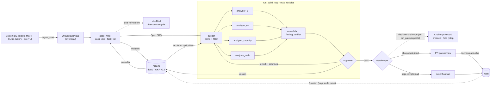

# plan.md · IA Factory (`apps/ia-factory`)

> **Estado:** v0.6 · **Fecha:** 2026-11-05
> **Repo:** <https://github.com/Manuelsierra95/ai-factory> (`origin`, rama `main`)
> **Base:** [`vercel-labs/eve-software-factory-template`](https://github.com/vercel-labs/eve-software-factory-template) (Foreman), **actualizado a eve `1.0.0-rc.5`**
> **Skills:** catálogo [`ericrisco/rsc-harness`](https://github.com/ericrisco/rsc-harness) (MIT, © 2026 Eric Risco) vendorizado y adaptado en `agent/skills/rsc/` (§8.10), **34 skills**
> **Runtime de agentes:** [eve](https://eve.dev) (Vercel, open source, Apache-2.0), ejecutado **en local**
> **Modelos:** proveedor directo vía [AI SDK](https://ai-sdk.dev/docs/foundations/providers-and-models) con API keys propias
> **Sandbox:** Docker local con contenedores efímeros, checkout de `FACTORY_REPO` desde GitHub y eliminación automática al terminar cada tarea
> **BRAIN:** bundle [Open Knowledge Format (OKF) **v0.2**](https://github.com/GoogleCloudPlatform/open-knowledge-format) en `docs/` (raíz del monorepo)
> **Tests del repo destino:** **e2e (Playwright)**; las unidades de la propia fábrica usan Vitest

---

## 0. Cómo usar este plan

- Está pensado para ejecutarse **por fases** (§14), cada una con criterios de aceptación (DoD) verificables.
- Regla para cualquier agente de código que lo implemente: **antes de escribir código eve, leer la guía correspondiente en `node_modules/eve/docs/`** (esos docs corresponden a la versión instalada; `eve.dev` documenta el último release, que puede ser más nuevo). eve está en **release candidate (`1.0.0-rc.5`)** y los bocetos de código de este documento son orientativos: no inventar APIs, confirmarlas contra la versión instalada.
- Las decisiones cerradas y las abiertas están en la §18. Si una abierta no se decide, se aplica la recomendada.
- **Las skills son el comportamiento de cada estación.** Antes de implementar una estación, leer su skill vendorizada (§8.10) y su referencia upstream en rsc-harness. Una estación sin skill se comporta como un prompt suelto: sin puertas, sin rúbrica y sin evidencia.
- **La fábrica no tiene modos.** No hay "modo desatendido" ni "modo estricto": se comporta siempre igual y decide si itera o cierra leyendo el estado real de la interacción (§3.6). Si estás buscando un flag que lo cambie, no existe: lo que cambia es si hay un humano en el bucle.

### 0.1 Registro de cambios

| Versión | Fecha | Cambios |
|---|---|---|
| v0.1–v0.2 | 2026-11-05 | Primer borrador; eve como runtime, ejecución local, Docker con sandboxes efímeros, modelos por proveedor directo, MCP + slash commands + CLI, BRAIN compartido |
| v0.3 | 2026-11-05 | Capa de skills desde rsc-harness; `idea-refinement`, `clarify`, `analyze`, `decision-challenge`, `decision-records`, `constitution`; estados `REFINING`/`CHALLENGING`/`COMPACTING`; fases ampliadas; D18–D21 |
| v0.4 | 2026-11-05 | Iteración continua (§3.6), eliminación de los modos, `Spec` como documento vivo, desafío de dirección (§11.5), `## Decisiones autónomas`, `maxIterations`, `ia-factory continue`; D22–D24 |
| **v0.5** | **2026-11-05** | **Correcciones tras verificar el plan contra eve, rsc-harness, OKF y el repo real.**  · **eve `1.0.0-rc.5`** (con la lista de migraciones desde `0.67.2`) · **Zod como fuente de verdad** de los contratos, puente `z.toJSONSchema()` · **e2e (Playwright)** como suite del repo destino, con contrato AC→título de test y `verify_tdd` por `--grep` · **Skills: `sdd` no existe** → `asdd` (sucesor renombrado); `sdd-init`, `plan`, `tasks` y `ftd` añadidos (34 en total); **`sdd-spec`/`tdd-workflow`/`okf-brain` no vienen del template** → se escriben 2 y `sdd-spec` se sustituye por `asdd` · **Sandbox: volumen compartido read-only** (D29) · **Desafío de decisión ejecutado en `run_gatekeeper.ts`** (D28) · **OKF v0.2** canónica: `generated: {by, at}`, `status: draft\|stable\|deprecated` (D31) · **Linter/TS unificados** en eslint+prettier+TS5+turbo (D26) · **Fase 0.5 (Fundación)** nueva: runner e2e, CI, contrato de checks, remote de GitHub · Side effects de git/BRAIN en **`"use step"`** (regla de eve) · Correcciones de contradicciones internas (lane/idea, `GATEKEEPING → ITERATING`, typo de sección, árbol duplicado, Fase 0 sin `vercel link`, `agent/sandbox/sandbox.ts`) · Decisiones **D25–D31** cerradas |
| **v0.7** | **2026-11-05** | **Fase 0 ejecutada.** · App `apps/ia-factory` sobre **eve `1.0.0-rc.5`**: migración de la API (compaction `threshold`, `limits.sessionUsage`, `defineInstructions({content})`, `ctx.agent().send().result()`), `modelContextWindowTokens` por estación (las instancias de proveedor directo no están en el catálogo del Gateway) · **Sandbox Docker local** (provider de eve) en lugar de Vercel Sandbox; credencial GitHub por **env de comando** (`GIT_CONFIG_*`), nunca en la línea de comandos ni en la imagen · **Fuera Vercel Connect**: credenciales propias (PAT o GitHub App con installation token) · **Fuera la extensión `@github-tools/eve-extension`** (importa `@vercel/connect` de forma dura): Fase 6 escribe un cliente REST propio · `FACTORY_REPO` se resuelve en el uso, no al cargar el módulo, para que `eve build`/`eve info` funcionen sin entorno · `factory.config.ts` con el contrato de `checks` (D37: instalación por sesión) · Plantilla de skills: solo `writing-quality` (el resto llega en Fase 2) · **Desviación de la §5**: las estaciones del template siguen vivas hasta la Fase 3-5 |
| **v0.6** | **2026-11-05** | **Cierre de D34–D37 y repo de destino.** · **Repo:** <https://github.com/Manuelsierra95/ai-factory> · **D34:** Playwright con **solo `chromium`** headless · **D35:** los tests e2e viven en **`packages/tests/`** (workspace `@workspace/tests`), no en `e2e/` raíz · **D36:** los analysers UI/UX **reutilizan la misma instalación y el mismo `webServer`** · **D37:** la instalación (`pnpm install`) es **por sesión**, en el volumen compartido (`checks.setup`), nunca en `prepare` |

---

## 1. Objetivo y alcance

Construir una **fábrica de software con IA** dentro del monorepo, como app `apps/ia-factory`, que reciba una tarea desde la sesión del IDE/TUI y la lleve hasta `main` (push directo o PR) siguiendo el flujo del diagrama:

**Tarea → Spec Writer (SDD) → Builder (rama + TDD) → Analysers en paralelo (UI, UX, Seguridad, Código) → Approver (bucle) → Gatekeeper → push a `main` | PR → documentación en el BRAIN**

### 1.1 En alcance (v1)

| Bloque | Contenido |
|---|---|
| Entrada | Tarea lanzada desde la sesión de Claude Code, OpenCode, Cursor, Codex o Gemini CLI (cliente MCP + slash commands + CLI `ia-factory`) o desde la TUI de eve |
| Ejecución | eve en la máquina del desarrollador (`eve dev`); sandboxes Docker efímeros con clon desde GitHub |
| Modelos | Proveedores directos vía AI SDK (`@ai-sdk/anthropic`, `@ai-sdk/openai`, `@ai-sdk/google`…) con API keys en `.env.local` |
| Agentes | Orquestador raíz + subagentes declarados en eve para cada caja del diagrama |
| BRAIN | Wiki OKF v0.2 en `docs/`, versionada en git, leída y escrita por la fábrica y leída también por las sesiones interactivas del IDE |
| Salida | Push fast-forward a `main` (baja complejidad) o PR para revisión humana (alta complejidad) |

### 1.1.1 Estado de la implementación (2026-11-05)

| Fase | Estado |
|---|---|
| **Fase 0.5** | **Hecha.** Suite e2e (Playwright, solo chromium) en `packages/tests` con el contrato `AC-<n> · <descripción>`; CI (lint + typecheck + e2e); remote de GitHub publicado; lint/TS unificados (eslint + prettier + TS 5 + turbo) |
| **Fase 0** | **Hecha en lo estructural.** App en `apps/ia-factory` sobre eve `1.0.0-rc.5`, compilada, con sandbox Docker local, credenciales propias y `factory.config.ts`. **Pendiente**: provider Docker propio con labels/TTL/janitor/volumen compartido (D29), imagen del sandbox con Playwright y sin sudo, y `pnpm factory:up` |
| Fases 1-7 | Pendientes |

### 1.2 Fuera de alcance (v1)

- Despliegue de la fábrica en servidor (v1 corre siempre en local).
- Acceso multi-desarrollador al BRAIN actualizado antes del merge (Fase 9).
- Intake desde GitHub Issues, Sentry y Linear; webhooks de GitHub; login OAuth y tracking de uso (Fase 8).
- Vercel Blob y Vercel AI Gateway.

---

## 2. Mapa del diagrama a componentes eve

| Elemento del diagrama | Componente | Ubicación | Primitiva eve |
|---|---|---|---|
| Tarea (prompt IDE/TUI) | Canal MCP + slash commands + CLI `ia-factory` + TUI | `agent/channels/mcp.ts`, `agent/channels/eve.ts`, `packages/factory-cli/` | Channel |
| Issue GitHub / Error Sentry | Backlog (Fase 8) | — | Channel / Connection |
| Login OAuth | Backlog (Fase 8): `oauthResource()` en el canal MCP | — | Channel auth |
| Spec Writer | `spec_writer` (con carriles `fast`/`full` + pre-estación `idea`) | `agent/subagents/spec_writer/` | Subagent declarado |
| BRAIN | Bundle OKF + librería + tools de lectura + escritor único | `docs/`, `packages/okf-brain/`, `agent/lib/brain/`, `agent/tools/brain_*.ts` | Tools + lib |
| Builder (crea rama, TDD) | `builder` | `agent/subagents/builder/` | Subagent declarado |
| Analysers (contexto limpio, tarea concreta, modelo propio) | `analyser_ui`, `analyser_ux`, `analyser_security`, `analyser_code` | `agent/subagents/analyser_*/` | Subagents declarados |
| Approver | Consolidación + `finding_verifier` + decisión **determinista** en código + `approver` | `agent/tools/run_build_loop.ts`, `agent/lib/pipeline/`, `agent/subagents/{finding_verifier,approver}/` | Workflow tool + subagents |
| Gatekeeper | Reglas duras en código + `gatekeeper` (scoring) | `agent/tools/run_gatekeeper.ts`, `agent/subagents/gatekeeper/` | Workflow tool + subagent |
| Push a main / PR para review | `ship_push_main`, `ship_pull_request` | `agent/tools/` | Tools raíz con política |
| Flechas "Documenta… al BRAIN" | `BrainStore.commit()` invocado desde código | `agent/lib/brain/` | Lib (escritor único) |
| Iteración de una feature (varias vueltas al bucle antes de la PR) | Detección de interacción humana + estado `ITERATING` | `agent/lib/pipeline/iteration.ts` | Código (raíz) |
| Refinamiento de la idea (pre-estación del Spec Writer) | `idea-refinement` dentro de `spec_writer` | `agent/subagents/spec_writer/skills/rsc/idea-refinement/` | Skill |
| Desafío de la decisión de envío | `decision-challenge` **ejecutado por `run_gatekeeper.ts`** (D28) | `agent/lib/pipeline/challenge.ts` | Código (raíz) |
| ADR de decisiones duraderas | `Decision` del BRAIN | `docs/decisions/` | Concepto OKF |
| Disciplina de cada estación | Catálogo de skills vendorizado | `agent/skills/rsc/` | Skills |

Los subagentes declarados de eve **no heredan nada del raíz** (ni instrucciones, ni tools, ni sandbox, ni historial; tampoco el estado — `defineState` no cruza la frontera padre/hijo). Eso cubre literalmente el requisito del diagrama de "contexto limpio, tarea concreta, modelo propio" para los Analysers.

Las skills **no son cajas del diagrama**: son la disciplina que cada caja ejecuta por dentro. El mapa completo skill → estación está en §8.10.

---

## 3. Arquitectura

### 3.1 Diagrama



### 3.2 Estrategia de orquestación

| Opción | Descripción | Pros | Contras |
|---|---|---|---|
| A. Orquestador LLM (como Foreman) | El modelo raíz llama a `run_<estación>` en orden según sus instrucciones | Flexible, poco código, igual que el template | El orden y los límites del bucle dependen del modelo; difícil de testear |
| B. Pipeline 100 % en código | Un único workflow tool secuencia todo | Determinista, testeable, coste predecible | Rígido; peor para aclaraciones con el usuario |
| **C. Híbrido (recomendada)** | El LLM raíz gestiona los bordes humanos (intake, aclaraciones, aprobación de spec, informe final). El núcleo (build → análisis → verificación → approver → bucle) y el gatekeeper son **código determinista** en workflow tools | Bucle y límites garantizados; conversación natural en los bordes | Dos sitios donde mirar al depurar |

Con C, el raíz solo dispone de cuatro operaciones de pipeline: `run_spec_writer`, `run_build_loop`, `run_gatekeeper` y `ship_*`. El bucle de revisión no puede saltarse porque no existe como herramienta suelta.

### 3.3 Máquina de estados de una tarea

```
RECEIVED → SPECIFYING ─┬─→ REFINING (carril idea) ──→ SPECIFYING
                       ├─→ CLARIFYING ──→ SPECIFYING (con las respuestas ya horneadas)
                       └─→ SPEC_READY ─┬─→ SPEC_APPROVAL (si aplica) → CONSISTENCY (si aplica) → SPEC_READY
                                       └─→ BUILDING → REVIEWING → VERIFYING ─┬─→ REWORK → BUILDING   (ciclo ≤ N)
                                                                             ├─→ GATEKEEPING → CHALLENGING ─┬─→ SHIPPING_PUSH → DONE
                                                                             │                               ├─→ SHIPPING_PR → DONE (PR abierta)
                                                                             │                               └─→ ESCALATED (veredicto `stop`)
                                                                             └─→ ESCALATED (ciclos agotados / bloqueo)
BUILDING → ITERATING → SPECIFYING (spec revisada, revision+1, misma rama y taskId)   ← la iteración ocurre ANTES del Gatekeeper
ITERATING → ESCALATED (maxIterations agotado | STOP del desafío de dirección)
Cualquier estado → CANCELLED (agent_cancel) | FAILED (error no recuperable)
En cualquier estado → COMPACTING (context-budget) | DECISION (ADR en `docs/decisions/`)
```

> **Corrección v0.5:** la iteración **no** pasa por el Gatekeeper. El Gatekeeper se ejecuta **una sola vez**, al cerrar la feature (§8.8, §11.4). El "desafío de dirección" (§11.5) es una estación ligera que ocurre al entrar en cada iteración, no el Gatekeeper. Por eso el diagrama y la tabla anterior ya no contienen `GATEKEEPING → ITERATING`.

El estado se guarda en el estado durable de la sesión eve (`defineState`), no en ficheros. En local, eve persiste las sesiones en `.eve/.workflow-data` (mundo de Workflow local). **El estado de `defineState` pertenece a la sesión y no cruza a los subagentes**: todo lo que deba persistir entre estaciones (decisión del Gatekeeper, `taskId`, `revision`) lo escribe y lee **el workflow tool raíz**, nunca un subagente.

### 3.4 Flujo detallado

1. **Intake.** El desarrollador lanza `/factory <tarea>` en su IDE (o la CLI/TUI). El preflight de la CLI determina el `baseRef` (§7.5). El raíz recibe la tarea y genera `taskId = YYYYMMDD-<slug>-<4hex>`. El triage distingue una **tarea** (algo que ya se puede especificar) de una **idea** (algo que aún no tiene dirección); solo las ideas entran en el carril `idea` del paso 2.
2. **Spec Writer.** `run_spec_writer` abre un hijo `spec_writer` con la tarea, el contexto y el `baseRef`. El hijo consulta el BRAIN y el código en su checkout de `origin/<baseRef>` y ejecuta, en este orden:
   1. **Idea refinement** (solo carril `idea`): `idea-refinement` produce un `IdeaBrief` con 5–8 direcciones realmente distintas, 3 finalistas, la lista "Not Now" y el experimento más barato que distingue a las dos mejores. El humano elige dirección antes de que exista la spec.
   2. **Spec (SDD).** Redacta `Problem` y `Spec` con requisitos EARS (en `full`), criterios Given/When/Then (`AC-n`) y plan de tests AC → test. La spec sigue la disciplina de `asdd` + `specify`: responde **qué puede hacer el usuario**, **qué resultado obtiene** (contra una referencia aprobada), **qué debe respetar** (decisiones y specs previas, leídas del BRAIN) y **cómo se prueba**; más un **"Fuera de alcance"** explícito. En `full` añade además **"Coste de no hacerlo"** y **"Alternativa más barata"** (gate de `specify`): son las dos únicas líneas de todo el flujo que preguntan si la cosa debería existir.
   3. **Clarify.** `clarify` recorre la taxonomía de ambigüedades sobre la spec recién escrita y devuelve `clarifications[]` **tipadas** (`pregunta abierta`, `suposición tomada`, `decisión diferida`, `área no formulable`), cada una con su impacto y, en el caso de la suposición, con su base.
   4. **Declaración.** `surfaces` afectadas, complejidad estimada y carril (`fast` o `full`).
3. **Aclaración.** El raíz plantea al usuario (en MCP aparece como `input_required`; en la TUI como tarjeta) **solo las `pregunta abierta`**: una `suposición tomada` se valida confirmando su base, una `decisión diferida` se deja como está y un `área no formulable` se anota sin preguntar. Con las respuestas, el raíz vuelve al paso 2 y la spec se **reescribe con las respuestas ya horneadas** (§9, `SpecWriterOutput.clarifications[].answer`): nada se resuelve en el aire ni queda solo en el chat.
4. **Aprobación de spec.** No es configurable ni un modo (§3.6): depende de si hay un humano. Si hay un humano, el raíz le muestra el resumen de la spec y espera su OK; su respuesta hornea la spec. Si no hay humano, la spec **se auto-aprueba** y su objeción queda escrita en `## Decisiones autónomas` (§3.6.4) — la objeción nunca bloquea, pero no se pierde. Si el humano está iterando, la aprobación ocurre **en cada iteración** sobre la spec revisada, no solo la primera vez.
   Antes de pedir el OK (o de auto-aprobar), si el gate de consistencia está activo, un subagente `analyze` contrasta la spec con la `constitution`, `conventions/` y `decisions/` vigentes y devuelve huecos, contradicciones y desvío de alcance — sin editar nada.
5. **Build loop** (`run_build_loop`, código):
   1. Crea la rama `factory/<taskId>` desde `origin/<baseRef>` (la caja "Crea una rama nueva" del diagrama). Su primer commit es `docs(brain): problem + spec <taskId>`, vía `BrainStore`.
   2. Recupera de forma **determinista** las lecciones activas cuyo `area`/`tags` cruzan con la spec (top-k) y las inyecta en el mensaje del Builder.
   3. `builder` trabaja en TDD sobre la rama: commit(s) `test(<id>): red` → `feat|fix(<id>): green` → `refactor` opcional. Ejecuta los checks del repo (§13.4) y hace `push_branch`.
   4. Los Analysers aplicables corren en paralelo sobre el SHA empujado. Solo ven rama, spec y criterios, nunca el razonamiento del Builder.
   5. **Consolidación (código).** Deduplica hallazgos por `rule` + fichero + rango de líneas.
   6. **Verificación.** Cada hallazgo `blocker`/`major` restante pasa a `finding_verifier` (contexto limpio, postura inicial: "el hallazgo es falso"). Solo cuenta si lo reproduce o lo traza en el código.
   7. **Approver (código).** `pass` si no queda ningún `blocker`/`major` confirmado. Si queda alguno, `rework` mientras `cycle < maxReviewCycles`; agotados los ciclos, `escalate`.
   8. En `rework`, el subagente `approver` consolida un único *rework brief* y redacta `LessonDraft[]` generalizables. `BrainStore` las persiste en la rama y el bucle vuelve a 5.3 con el brief.
6. **Gatekeeper** (`run_gatekeeper`): reglas duras en código (tamaño de diff, rutas protegidas, dependencias nuevas, ciclos, `baseRef`…) + subagente `gatekeeper` (score 1–5 con rúbrica). Si la ruta candidata es **push a `main`**, `run_gatekeeper.ts` ejecuta además el **desafío de decisión** (`decision-challenge`) sobre la decisión "enviar sin revisión humana": materializar → aislar → atacar → probar → reconciliar → veredicto (`proceed` / `hold` / `stop`). El veredicto **solo endurece** la ruta: `proceed` deja continuar, `hold` fuerza PR y `stop` escala sin enviar nada. Con reglas duras, `score` y veredicto, el código decide la ruta final (§11.4) y la guarda en estado durable ligada a `taskId + headSha`.
7. **Solution doc.** Antes de enviar, `BrainStore` escribe `docs/solutions/<taskId>.md` (qué se hizo y por qué) en la rama. La documentación llega a `main` **si y solo si** llega el código.
8. **Ship.**
   - `ship_push_main`: rebase sobre `origin/main`, re-ejecuta checks y hace push **fast-forward only**. Si `main` se movió y hay conflicto ⇒ PR. Solo posible si `baseRef = main`.
   - `ship_pull_request`: abre PR contra `baseRef` con spec, informes verificados, decisión del Gatekeeper y lecciones.
9. **Cierre o iteración.** Aquí está la única bifurcación del pipeline (§3.6). La fábrica comprueba, sin ninguna configuración que lo active:
   - **¿queda un humano con input pendiente o una spec sin cerrar?** → **ITERATING**: no hay PR ni push. Se actualiza la `Spec` (subiendo `revision`), se reescriben los AC afectados, el `Checklist` conserva la evidencia ya observada, `Next` apunta al siguiente paso y el pipeline vuelve al paso 2 **con el mismo `taskId` y la misma rama**.
   - **¿no queda humano, o el humano ha pedido cerrar?** → **cierre**: el raíz devuelve resultado estructurado (ruta, SHA o URL de PR, documentos del BRAIN, ciclos, iteraciones, hallazgos reportados → únicos → confirmados, decisiones autónomas y coste). `ia-factory fetch` trae la rama al checkout local.

   Entre iteración y cierre no hay ningún otro criterio. El `Gatekeeper` (§11) se ejecuta **una sola vez**, al final: por eso una feature puede iterar diez veces sin abrir ni una PR.

### 3.5 Runtime y ciclo de vida de los sandboxes Docker

- **Provider:** `DockerSandboxProvider`, implementado detrás de `defineSandboxProvider()` (`eve/sandbox/provider`). eve y las estaciones no dependen directamente de la API de Docker.
- **Unidad real: la sesión de eve.** eve crea **un contenedor por sesión de subagente**, no por tarea. Un subagente que declara `defineSandbox()` tiene contenedor propio; uno con `defineParentSandbox()` comparte el del padre (y entonces **no puede** declarar skills propias — restriction de eve, §8.10.6).
- **Optimización D29 (volumen compartido).** Para que N contenedores no impliquen N clones ni N instalaciones:
  - El **Builder** es el único escritor. Monta un volumen Docker nombrado `ia-factory-<taskId>-src` y hace allí el clone + checkout de `origin/<baseRef>` + `pnpm install`.
  - Todas las demás estaciones montan **ese mismo volumen en solo lectura** y trabajan sobre el SHA empujado. No clonan, no instalan, no escriben.
  - El volumen se borra al alcanzar un estado terminal, con el mismo mecanismo idempotente que los contenedores.
  - Resultado: **1 clone + 1 install por tarea**, N contenedores ligeros, un solo escritor.
- **Creación:** el Sandbox Manager crea un contenedor con imagen fijada por digest (§13.1), límites de CPU/RAM/PIDs, usuario no privilegiado, capacidades eliminadas, `no-new-privileges`, perfil seccomp/AppArmor y red restringida.
- **Identificación:** todos los recursos llevan labels Docker, como `ia-factory.managed=true`, `ia-factory.task-id=<taskId>`, `ia-factory.sandbox-id=<sandboxId>` y `ia-factory.created-at=<timestamp>`. La limpieza solo puede actuar sobre recursos con `ia-factory.managed=true`.
- **Finalización normal:** al alcanzar un estado terminal (`DONE`, `FAILED`, `CANCELLED` o `ESCALATED`), el workflow primero persiste el resultado, logs necesarios, métricas y referencias a commits/PR; después detiene y elimina el contenedor y sus volúmenes/workspace temporales. La rama y los commits ya empujados a GitHub no se eliminan.
- **Cancelación y errores:** `agent_cancel`, timeout, error irrecuperable o agotamiento de presupuesto disparan la misma rutina de cleanup, que debe ser idempotente y segura ante llamadas repetidas.
- **Cierre inesperado:** un proceso `sandbox janitor` al arrancar `eve` y periódicamente busca recursos gestionados que hayan superado `sandboxTtlMinutes` o cuyo `taskId` ya esté en estado terminal. Los detiene y elimina. No elimina recursos sin las labels de gestión ni tareas activas con heartbeat vigente.
- **TTL y heartbeat:** cada sandbox tiene `createdAt`, `lastHeartbeatAt`, `expiresAt` y estado. El heartbeat se renueva mientras exista actividad; un TTL máximo evita contenedores abandonados indefinidamente. Los valores se configuran, no se codifican en el provider.
- **Retención de diagnóstico:** los logs y artefactos que deban conservarse se copian fuera del contenedor antes de eliminarlo. En desarrollo se puede habilitar una retención temporal configurable para depuración, sin convertir los sandboxes en entornos persistentes.
- **Fallback de limpieza:** si la eliminación falla, el recurso queda registrado como `cleanup_pending`; el janitor reintenta con backoff y genera una alerta tras superar el número máximo de intentos.

La eliminación automática es un requisito funcional, no una optimización: ningún contenedor sandbox debe permanecer activo después de que su tarea haya terminado y se hayan persistido sus resultados.

> **Nota de eve (verificada):** eve ya llama al `stop()`/`onSessionEnd()` del provider cuando termina la sesión. El provider custom implementa ese `stop()` como la eliminación real del contenedor y del volumen; laroutine de cleanup de la fábrica añade idempotencia, labels, TTL y janitor.

### 3.6 Iteración continua: una fábrica, sin modos

**Requisito.** La fábrica no tiene modos. No hay "modo desatendido", ni "modo estricto", ni un interruptor que el usuario gire. **Siempre se comporta igual**: ejecuta Spec Writer → Builder → Analysers, y cuando llega al final del bucle decide si **termina** o **sigue iterando** — y esa decisión la toma leyendo el estado real de la interacción, no una configuración.

#### 3.6.1 La señal: hay un humano en el bucle

| Hecho observable | Dónde vive | Qué significa |
|---|---|---|
| **La sesión sigue viva** | Estado durable de la sesión eve | Hay un turno activo o recién terminado esperando |
| **Hay input pendiente** | `agent_get` devuelve `input_required` con `interactions` | Alguien tiene una pregunta abierta |
| **La spec no está cerrada** | `Spec.status ≠ "shipped"` en el BRAIN | La feature sigue en construcción |
| **La interacción vino de un humano** | El mensaje de `agent_start` / `agent_update` lleva `source: human \| automation` | Un ticket de Sentry es `automation`; un `/factory` del IDE es `human` |

**Regla de detección (una sola frase):** la tarea itera mientras haya un humano que pueda seguir mandando mensajes; termina cuando el humano dice que termine, o cuando ya no queda nadie a quien preguntarle.

Esto es exactamente el patrón que la skill `asdd` llama **autopilot**: un "sí" inicial del usuario autoriza toda la cadena, y el pipeline corre entero sin pausas — pero para la ambigüedad genuina y las acciones irreversibles **sigue parando**. Aquí no hay ni un flag: el "sí" es la propia presencia del humano.

#### 3.6.2 Qué cambia cuando hay humano: el bucle no termina, se abre

En `ITERATING` la fábrica **no crea una tarea nueva**: reutiliza el mismo `taskId`, la misma rama `factory/<taskId>` y la misma spec, y vuelve al Spec Writer con el mensaje nuevo. Eso es lo que hace que la iteración sea barata: no se re-construye el contexto, se **incrementa**.

**La spec viva.** Se adapta el patrón de la skill `ftd` del harness: un documento por feature con `Intent`, `Scope`, `Checklist`, `Evidence` y `Next`. En la fábrica ese documento es la propia `Spec` del BRAIN, ampliada con:

| Sección | Para qué |
|---|---|
| `## Checklist` | Un ítem por criterio de aceptación, con la evidencia observada que lo marca. **El checkbox no es la prueba**: se marca cuando el test pasa, no cuando se escribe |
| `## Evidence` | La salida real observada por ítem completada |
| `## Next` | El siguiente paso exacto. Una interrupción cuesta cero |
| `## Decisiones autónomas` | Lo que se decidió solo y por qué (§3.6.4) |

> **Nota:** `ftd` escribe su documento de feature **fuera** del repo de código. Aquí vive **dentro** (`docs/specs/`), porque en esta fábrica la spec es la unidad que viaja con la rama y llega a `main`. Es una desviación deliberada de `ftd`.

Cada iteración **actualiza la spec existente** en vez de crear otra: la `Spec` gana `revision: N` en el frontmatter y las secciones de arriba. El `Spec` sigue siendo la unidad que viaja en la rama.

#### 3.6.3 Los dos challenges: el de dirección y el de envío

| | **Desafío de dirección** | **Desafío de envío** |
|---|---|---|
| Pregunta | ¿Esta iteración sigue la dirección que elegí? | ¿Esto debe llegar a `main` sin revisión humana? |
| Cuándo | Al empezar cada iteración, sobre el diff acumulado | En el Gatekeeper, antes de shippear |
| Dónde se ejecuta | `agent/lib/pipeline/challenge.ts`, invocado por el orquestador raíz | `agent/lib/pipeline/challenge.ts`, invocado por `run_gatekeeper.ts` (D28) |
| Entrada | Spec + diff acumulado + brief original | Spec + diff + veredictos + reglas duras |
| Veredicto | `PROCEED` (sigue) · `HOLD` (pregunta al humano) · `STOP` (aborta la feature) | `PROCEED` · `HOLD` (fuerza PR) · `STOP` (escala) |
| Efecto | Define si la **próxima** iteración tiene sentido | Define la **ruta** de envío |

El desafío de dirección es el que responde a "quiero iterar sin que se hagan PRs cada vez que se acaba una iteración": **no hay PR por iteración porque la PR no está en el bucle**.

Y como en §11.4, el desafío solo puede endurecer: un `PROCEED` de dirección no fuerza a seguir iterando si no queda nadie; un `HOLD` de dirección siempre pregunta.

#### 3.6.4 Autonomía sin preguntas: qué se decide solo y qué se escribe

Cuando no hay humano al que preguntar, la fábrica decide — pero **no en silencio**. La skill `specify` lo formula bien: *la objeción nunca bloquea, es una divergencia, no un veto* — y si el usuario decide continuar, **la razón se escribe en la spec**.

```markdown
## Decisiones autónomas
| Decisión | Alternativa descartada | Por qué | Reversible |
|---|---|---|---|
| Se usa `idempotency_key` en la tabla de envíos | Reintento con backoff | El backoff no cubre la ventana de crash | Sí (1 commit) |
```

> **Corrección v0.5:** el encabezado es exactamente `## Decisiones autónomas`. Cualquier parser que lo busque debe usar esta cadena literal (la v0.4 lo escribía mal en un ejemplo).

Reglas:

- Se escribe **siempre** que la fábrica elija entre alternativas razonables sin preguntar.
- **Reversible = sí/no** es obligatorio: si no es reversible, es una `Decision` del BRAIN (§6.3), no una línea en la tabla.
- Se incluye en el informe final y en el cuerpo de la PR. Quien revise ve exactamente lo que no se le preguntó.
- Una decisión autónoma **no** es una excepción a las reglas duras: si toca ruta protegida o cambia contrato público, el Gatekeeper manda igual.

#### 3.6.5 Cuándo termina la iteración

| Salida | Condición | Resultado |
|---|---|---|
| **Cierre humano** | El humano responde "cierra", "dale", "envía" | Gatekeeper → PR o push |
| **Cierre por convergencia** | Todos los AC de la spec vigente están cubiertos con evidencia, los Analysers pasan y no hay `pregunta_abierta` pendiente | Gatekeeper → PR o push |
| **Escalado** | `maxIterations` agotado, o un `STOP` del desafío de dirección, o el humano pide cancelar | `ESCALATED` con informe; la rama queda en GitHub |

Convergencia automática **solo aplica si no hay humano esperando**: si hay un humano con input pendiente, se le pregunta primero.

#### 3.6.6 El límite de iteraciones

`maxReviewCycles` (3) limita los ciclos de **revisión** dentro de una iteración (el bucle rework del §3.4). `maxIterations` (8 por defecto) limita las **iteraciones** de una feature. Son dos contadores distintos:

- `maxReviewCycles` agotado → `ESCALATED` (el bucle interno no converge: hay un problema de fondo).
- `maxIterations` agotado → `ESCALATED` con un informe que dice "la feature sigue abierta, estas son las iteraciones y el estado"; la rama se conserva y el humano puede retomarla.

Los presupuestos pasan a ser **por iteración**, no por tarea: `maxTokensPerIteration` y `maxWallClockMinutesPerIteration`. El total de la tarea es la suma, con un tope global aparte.

#### 3.6.7 Cómo se comunica la iteración

| Canal | Cómo llega un mensaje nuevo a la sesión viva | Nota |
|---|---|---|
| **CLI `ia-factory`** | `ia-factory continue <id> --message-file <f>` → `POST /eve/v1/session/<sessionId>` con `{ "message": … }` | El follow-up **continúa la misma sesión, con el mismo historial y el mismo estado** |
| **API de sesión (HTTP)** | `POST /eve/v1/session/<sessionId>` con `{ "message": … }` | Base de la CLI y de cualquier integración propia |
| **MCP** | `agent_start` (nueva invocación) o `agent_update` para responder a `input_required` | `agent_update` solo acepta respuestas a interacciones abiertas, no mensajes libres: una iteración por MCP **reabre la invocación** con `agent_start` reutilizando `sessionId` |

> **Verificado en eve:** `POST /eve/v1/session/<sessionId>` acepta **exactamente uno** de `message` o `answers`. El follow-up continúa la misma sesión con el mismo historial y estado. El `message` usa `turnPolicy: "steer"` por defecto: si hay un turno en curso, el mensaje lo dirige en lugar de esperar.
> **Restricción real de eve:** un `agent_start` **nuevo** crea una sesión nueva y perdería el estado. Por eso la CLI guarda el `sessionId` junto al `invocationId` en `.factory/invocations.json`, y `continue` lo reutiliza.

**Cómo se distingue una iteración de una respuesta.** La CLI no adivina: `continue` significa "nueva instrucción" y `answer` significa "respuesta a esta pregunta".

**El límite de la autonomía.** Cuando la iteración la dispara una automatización y no un humano (Sentry, webhook, cron), el mensaje entrante lleva `source: automation`. La fábrica lo trata igual —itera— pero la sección `## Decisiones autónomas` registra cada elección. La diferencia entre humano y automatización no cambia el pipeline: cambia **quién lee el informe**.

---

## 4. Estructura del monorepo

```
<monorepo>/
├── apps/
│   ├── ia-factory/                     # proyecto eve (derivado del template, actualizado a eve 1.0.0-rc.5)
│   │   ├── agent/
│   │   │   ├── agent.ts                # modelo raíz + presupuesto de sesión
│   │   │   ├── instructions.ts         # prompt del orquestador
│   │   │   ├── sandbox/sandbox.ts      # sandbox raíz (escritor del BRAIN)  ← carpeta, no fichero (§4.1)
│   │   │   ├── channels/
│   │   │   │   ├── mcp.ts              # entrada desde IDEs y CLI
│   │   │   │   └── eve.ts              # auth de rutas + localDevUser (TUI)
│   │   │   ├── extensions/
│   │   │   │   └── github.ts           # reducido: lecturas + createPullRequest
│   │   │   ├── tools/
│   │   │   │   ├── agent.ts            # disableTool(): el raíz no puede saltarse estaciones
│   │   │   │   ├── run_spec_writer.ts
│   │   │   │   ├── run_build_loop.ts
│   │   │   │   ├── run_gatekeeper.ts
│   │   │   │   ├── ship_push_main.ts
│   │   │   │   ├── ship_pull_request.ts
│   │   │   │   ├── brain_search.ts
│   │   │   │   └── brain_read.ts
│   │   │   ├── subagents/
│   │   │   │   ├── spec_writer/        # agent.ts, instructions.md, sandbox/, tools/, skills/
│   │   │   │   ├── builder/
│   │   │   │   ├── analyser_ui/
│   │   │   │   ├── analyser_ux/
│   │   │   │   ├── analyser_security/
│   │   │   │   ├── analyser_code/
│   │   │   │   ├── finding_verifier/
│   │   │   │   ├── approver/
│   │   │   │   └── gatekeeper/
│   │   │   ├── skills/
│   │   │   │   ├── writing-quality/    # conservada del template
│   │   │   │   ├── tdd-workflow/       # propia (§8.10.8): convención red/green + verify_tdd
│   │   │   │   ├── okf-brain/          # propia (§8.10.8): esquema del BRAIN y reglas de escritura
│   │   │   │   ├── rsc/                # 34 skills de rsc-harness vendorizadas (MIT)
│   │   │   │   └── LICENSE.rsc-harness
│   │   │   └── lib/
│   │   │       ├── config.ts           # carga factory.config.ts
│   │   │       ├── models.ts           # MODELS: objetos de proveedor AI SDK
│   │   │       ├── trust.ts            # simplificado (principal local)
│   │   │       ├── brain/              # BrainStore + GitBrainStore
│   │   │       ├── git/                # validateBranch, brokerPolicy, ff-push
│   │   │       ├── github/             # credentials, approval policies, repo-sandbox
│   │   │       ├── pipeline/           # decide(), consolidate(), hardRules(), challenge.ts, iteration.ts
│   │   │       ├── stations/schemas.ts # contratos zod (§9) + puente a JSON Schema
│   │   │       └── cost/rates.json     # tabla de precios fechada (cost-tracking)
│   │   ├── evals/
│   │   ├── factory.config.ts
│   │   ├── .env.local                  # API keys y credenciales (gitignored)
│   │   ├── AGENTS.md
│   │   └── package.json
│   └── web/                            # app Next.js del monorepo (destino habitual de la fábrica)
├── packages/
│   ├── okf-brain/                      # parse/valida/indexa/busca OKF v0.2 + CLI brain
│   ├── factory-cli/                    # bin `ia-factory` (cliente MCP ligero)
│   └── tests/                          # suite e2e (Playwright) del repo destino · @workspace/tests
├── docs/                               # BRAIN (bundle OKF v0.2)
├── .claude/commands/factory*.md        # slash commands Claude Code
├── .opencode/command/factory*.md       # slash commands OpenCode (verificar ruta)
├── .cursor/commands/factory*.md        # slash commands Cursor (verificar ruta)
├── .mcp.json                           # Claude Code
├── .cursor/mcp.json                    # Cursor
├── opencode.json                       # OpenCode
├── .factory/                           # estado local de la CLI (gitignored)
├── .github/workflows/ci.yml            # lint + typecheck + e2e + brain lint
├── lefthook.yml                        # pre-commit: brain lint (o husky)
├── .gitattributes                      # merge=union en log.md y lessons/
├── CLAUDE.md / AGENTS.md               # instrucciones para las sesiones del IDE (leer docs/)
├── pnpm-workspace.yaml
└── turbo.json
```

Convención de nombres: directorios de subagentes en `snake_case`. El nombre del directorio es el nombre de la herramienta que ve el modelo, y comparte espacio de nombres con las tools: por eso los wrappers se llaman `run_spec_writer` y no `spec_writer` (eve rechaza el build si colisionan).

### 4.1 Regla de layout de sandbox (verificada en eve)

eve da **error de build** si existe `agent/sandbox.ts` junto a la carpeta `agent/sandbox/`. Como el agente raíz lleva skills (`rsc/asdd`, `rsc/agent-safety`), su definición va en **`agent/sandbox/sandbox.ts`**, no en `agent/sandbox.ts`. Lo mismo para cualquier subagente con skills propias.

### 4.2 Regla de side effects en workflow tools (verificada en eve)

El cuerpo de un workflow tool **se re-ejecuta en cada replay** y debe ser determinista. Todo lo que toca el mundo exterior —`BrainStore.commit()`, `git push`, creación de ramas, llamadas al Gatekeeper que abren una PR— va en funciones marcadas **`"use step"`**, nunca en el cuerpo del workflow. Sin esto, un replay vuelve a empujar la rama y duplica commits.

---

## 5. Cambios respecto al template

| Elemento del template | Acción | Notas |
|---|---|---|
| `agent/channels/github.ts` | Eliminar (v1) | Vuelve en Fase 8 para issues y webhooks |
| `agent/channels/linear.ts`, `agent/connections/linear.ts` | Eliminar | Fuera de alcance |
| `agent/channels/eve.ts` | Conservar | `localDevUser` para la TUI |
| `agent/channels/mcp.ts` | **Nuevo** | Entrada desde IDEs y CLI |
| `agent/extensions/github.ts` | **Eliminar** (Fase 0) | La extensión `@github-tools/eve-extension` importa `@vercel/connect` de forma dura, y la fábrica no usa Vercel Connect. La Fase 6 escribe tools propias sobre la API REST de GitHub: `github_create_pull_request`, `github_get_pull_request`, `github_add_pull_request_comment` |
| Modelos vía AI Gateway (ids `vendor/modelo`, auth OIDC) | **Sustituir** | Objetos de proveedor AI SDK con API keys propias (§8.9) |
| `agent/sandbox.ts`, `subagents/*/sandbox.ts` | Adaptar | Provider Docker custom que clona `FACTORY_REPO` y limpia al terminar |
| `subagents/classifier` | Fusionar en `spec_writer` | El triage y la elección de carril forman parte de la spec |
| `subagents/analyst` | Sustituir por `spec_writer` | Plan → spec SDD con criterios Given/When/Then |
| `subagents/implementer` | Renombrar a `builder` | Añadir disciplina TDD verificable |
| `subagents/reviewer` | Dividir en 4 `analyser_*` + `finding_verifier` | Cada uno con rúbrica y modelo propios |
| `subagents/researcher` | Conservar (opcional) | Útil para el Spec Writer en tareas con dependencias externas |
| `tools/*_user_preferences.ts` | Eliminar | Dependían de Blob |
| `tools/read_factory_brain.ts`, `update_factory_brain.ts` | Sustituir | `brain_search`, `brain_read` (lectura) + `BrainStore` (escritura desde código) |
| `lib/blob.ts`, `lib/user-preferences.ts`, `lib/factory-brain.ts` | Eliminar | Nuevo `lib/brain/` |
| `lib/artifacts/` (handoff en Blob) | Eliminar | La spec vive en `docs/specs/` dentro de la rama; los informes viajan inline acotados por schema |
| `lib/trust.ts` | Simplificar | Un principal local atendido; se mantiene la abstracción para Fase 8 |
| `lib/github/approval.ts` | Reescribir | Políticas de ship (`shipPushPolicy`, `shipPrPolicy`) |
| `lib/github/git-remote.ts` | Conservar | `validateBranch` sigue rechazando `main`; única excepción controlada en `ship_push_main` |
| `lib/github/repo-sandbox.ts` | Adaptar | Checkout de `origin/<baseRef>` en lugar de siempre la rama por defecto |
| `lib/models.ts` | Reescribir | Una entrada por estación, como objeto de proveedor |
| `skills/triaging-issues`, `skills/github-linear-bridging` | Eliminar | Sin intake GitHub/Linear |
| `skills/writing-quality` | **Conservar** | Única skill que el template trae y encaja |
| `evals/` | Reescribir | Modelo juez con proveedor directo (§15) |
| Variables `LINEAR_CONNECTOR`, `FACTORY_LABEL` | Eliminar | — |
| `biome.jsonc` + `ultracite` | **Eliminar** | D26: el monorepo se unifica en eslint + prettier (§4.3) |
| `typescript@7.0.2` | **Eliminar** | D26: se usa el TypeScript 5 del monorepo |
| `package.json` del template (nombre, scripts, `imports`) | Reescribir | Se integra en el workspace y en turbo |

Conservar `LICENSE` (MIT) y la atribución al template original.

### 5.1 Migración de eve `0.67.2` → `1.0.0-rc.5` (D25)

El template pinea `eve: ^0.67.2`, que con semver queda clavado en la serie `0.67.x`. Se sube a **`1.0.0-rc.5`** (publicada 2026-11-05) y se migra lo siguiente:

| Cambio en eve | Impacto en la fábrica |
|---|---|
| `eve/extensions/code`: `code__apply_patch` eliminado → `eve/tools/edit_file` (`path` + `edits`) | Los sandboxes que usaban la extensión de código se adaptan; `edit_file` sustituye al parche |
| `code__grep` eliminado → `eve/tools/grep` | Sin impacto directo (nuestras stations declaran sus propias tools) |
| `code__worker` (subagente read-only) eliminado | El plan **no** lo usaba; el `finding_verifier` ya es un subagente propio |
| `code__lookup-agent-run` eliminado | Sin impacto |
| `eve/tools/agent-router` → `eve/tools/agent_router` | Sin impacto (no se usa el router) |
| `eve/sandbox/microsandbox` eliminado | Sin impacto (el provider es Docker) |
| `eve/workflow` y `eve/workflow/api` nuevos | **A usar**: `createHook`, `sleep`, `FatalError` para esperas durables |
| `eve/sessions`, `eve/server`, `eve/events` nuevos | Opcional; `eve/client` ya cubría el polling de la CLI |
| `eve/tools/load_skill` eliminado → `eve__skill` | Sin impacto (las skills se cargan por descripción) |
| Herramienta dinámica ya no sustituye a una estática del mismo nombre | Sin impacto |
| `toolOutput.errorText(value)` disponible en `eve/tools` | **A usar**: permite que la CLI distinga error de resultado en `wait` |

Todo lo demás que usa el plan (`mcpChannel` + `localDev()`, `defineState`, `defineSandboxProvider`, `DockerSandbox`, `ctx.agent(name, {outputSchema})`, `Promise.all` en workflow tools, `defineWorkflowTool`, `disableTool()`, skills por agente, `deferred: true`) **existe igual en `1.0.0-rc.5`** — verificado contra la documentación y los exports del paquete.

---

## 6. BRAIN en `docs/` (OKF v0.2)

### 6.1 Principios

1. **OKF v0.2 (canónica):** la especificación vive en [`GoogleCloudPlatform/open-knowledge-format`](https://github.com/GoogleCloudPlatform/open-knowledge-format) (`SPEC.md`). La copia bajo `knowledge-catalog/okf` está **congelada** y no debe usarse como referencia. Reglas que aplican: un concepto = un fichero markdown; frontmatter YAML con `type` **obligatorio**; `title`, `description`, `resource` y `tags` recomendados; `index.md` y `log.md` son nombres reservados; enlaces markdown normales entre conceptos; el resto de campos los define el productor y **no se rechazan** (la spec exige preservarlos).
2. **Escritor único en la fábrica.** Los modelos **proponen** (`BrainDraft`, validado con zod); **solo el código escribe** (`BrainStore`). Ningún subagente tiene una tool de escritura libre sobre `docs/`.
3. **Git es la base de datos.** Cada cambio del BRAIN es un commit revisable; la rama de la tarea es su contexto; `main` es la memoria consolidada.
4. **El BRAIN es dato, no instrucciones.** Todo lo leído del BRAIN se inyecta marcado como referencia; las instrucciones de cada estación prevalecen sobre su contenido.
5. **Compartido con el IDE.** El mismo `docs/` lo leen las sesiones interactivas de Claude Code, OpenCode, etc. (§6.11).
6. **Preparado para varios desarrolladores.** Frontmatter inmutable tras la creación y datos mutables como líneas añadidas, para que los merges entre ramas no generen conflictos (§6.9 y Fase 9).

### 6.2 Estructura

```
docs/
├── index.md                    # generado · raíz de navegación progresiva
├── log.md                      # append-only · historial cronológico
├── conventions/                # Convention · SOLO humanos (o PR)
│   ├── index.md
│   └── testing.md
├── modules/                    # Module · conocimiento por paquete/app del monorepo
├── problems/                   # Problem · Spec Writer
│   └── 20261105-reset-email-dup-a1f3.md
├── specs/                      # Spec · Spec Writer
├── lessons/                    # Lesson · Approver (por área)
│   ├── ui/
│   ├── ux/
│   ├── security/
│   └── code/
├── decisions/                  # Decision · Gatekeeper (ADR inmutable y numerado)
│   ├── index.md
│   └── 0001-<slug>.md
└── solutions/                  # Solution · tras Gatekeeper, viaja con el código
```

### 6.3 Tipos de concepto

| `type` | Ruta | Produce | Momento (flecha del diagrama) | Campos propios |
|---|---|---|---|---|
| `Problem` | `problems/<taskId>.md` | `spec_writer` | "Documenta el problema al BRAIN" | `task_id`, `source` (`ide`/`cli`/`tui`) |
| `Spec` | `specs/<taskId>.md` | `spec_writer` | "Escribe la spec con SDD" | `task_id`, `lane`, `status`, `complexity`, `surfaces`, `problem`, `base_ref`, `revision?` |
| `Lesson` | `lessons/<area>/<rule-slug>.md` | `approver` | "Documenta por qué no pasó la revisión" | `area`, `rule`, `severity`, `fingerprint`, `first_seen` |
| `Solution` | `solutions/<taskId>.md` | código + `gatekeeper` | "Documenta la solución y su porqué" | `task_id`, `route`, `spec`, `lessons_triggered`, `review_cycles` |
| `Module` | `modules/<paquete>.md` | humanos; fábrica vía PR | Mantenimiento | `path`, `owners` |
| `Convention` | `conventions/<tema>.md` | humanos | Promoción de lecciones recurrentes | `applies_to` |
| `Decision` | `decisions/<NNNN>-<slug>.md` | `gatekeeper` | Congela una elección difícil de revertir | `decision_id`, `status`, `date`, `supersedes`, `context`, `options`, `consequences` |

**Campos OKF v0.2 en nuestros documentos** (D31):

- `type` — obligatorio.
- `title`, `description` — recomendados.
- `generated: { by: "ia-factory/<station>", at: <ISO 8601> }` — **sustituye al `timestamp` de v0.4**. La spec exige `generated.by` dentro de `generated`.
- `status: draft | stable | deprecated` — lifecycle OKF. Para una `Lesson` recién creada por la fábrica: `draft`; cuando una persona la revisa y la promueve: `stable`; cuando se retira: `deprecated`.
- **El ciclo de promoción de lecciones** (`active` / `candidate` / `obsolete`) **no** usa el `status` de OKF (que significa otra cosa): sigue en el fichero lateral `docs/lessons/status.md`, mantenido por humanos. La spec OKF tolera campos extra: nuestros campos propios son conformes.
- `tags`, `resource` — opcionales; `resource` puede apuntar a la URL del PR o del ticket.

### 6.4 Ejemplos

**Spec (carril `full`)**

```markdown
---
type: Spec
title: El reset de contraseña envía un único email
description: Spec SDD de la tarea 20261105-reset-email-dup-a1f3.
tags: [auth, email, bug]
generated: { by: "ia-factory/spec_writer", at: 2026-11-05T09:40:00Z }
status: draft
task_id: 20261105-reset-email-dup-a1f3
lane: full
status_spec: approved
complexity: low
surfaces: [code, security]
base_ref: main
problem: /problems/20261105-reset-email-dup-a1f3.md
---

# Contexto
# Objetivo
# Resultado esperado (referencia)
# Requisitos (EARS)
- R1. WHEN el usuario solicita un reset THE SYSTEM SHALL enviar exactamente un email por solicitud.
# Criterios de aceptación
- AC-1. Given un usuario registrado, When solicita un reset, Then se encola exactamente un email.
- AC-2. Given un reintento del worker, When se reprocesa el mensaje, Then no se envía un segundo email.
# Diseño
# Plan de tests (AC → test)
| AC | Test e2e | Título Playwright |
|---|---|---|
| AC-1 | `packages/tests/auth/reset.spec.ts` | `AC-1 · encola un email` |
| AC-2 | `packages/tests/workers/mail.spec.ts` | `AC-2 · idempotente ante reintento` |
# Fuera de alcance
# Riesgos
# BRAIN consultado
- [Handlers de cola idempotentes](/lessons/code/idempotent-handlers.md)
```

> **Nota:** el campo de lifecycle de la spec es `status_spec` porque `status` está reservado por OKF para `draft|stable|deprecated`. El estado de la *feature* (`approved`, `in-progress`, `shipped`) vive en `status_spec`; el `status` OKF refleja si el documento está revisado.

En carril `fast` la spec se reduce a **Objetivo**, **Criterios de aceptación** y **Plan de tests**. Los AC y el TDD siguen siendo obligatorios.

**Spec viva** (feature que se itera, §3.6.2). Mismo documento, `revision` incrementada y cuatro secciones adicionales:

```markdown
---
type: Spec
title: Panel de métricas del proyecto
generated: { by: "ia-factory/spec_writer", at: 2026-11-05T09:40:00Z }
status: draft
task_id: 20261105-panel-metricas-7c21
lane: full
revision: 3
status_spec: in-progress
---

# Contexto
# Objetivo
# Requisitos (EARS)
# Criterios de aceptación
- AC-1. Given un proyecto con datos, When se abre el panel, Then se ve el total de tareas por estado.
- AC-2. Given un rango de fechas, When se filtra, Then el total se recalcula.
- AC-3. Given un export, When se pulsa "descargar", Then se genera un CSV con los datos filtrados.
# Checklist
- [x] AC-1 · `packages/tests/metrics/total.spec.ts › AC-1` · e2e · evidencia: 1 passed
- [x] AC-2 · `packages/tests/metrics/filter.spec.ts › AC-2` · e2e · evidencia: 1 passed
- [ ] AC-3 · `packages/tests/metrics/export.spec.ts › AC-3` · e2e · evidencia: —
# Evidence
- AC-2 · `pnpm --filter @workspace/tests e2e --grep "AC-2"` → 1 passed (2026-11-05T11:20Z)
# Next
Implementar AC-3 siguiendo el patrón de export de `reports/weekly` (revisar `docs/conventions/export.md`).
## Decisiones autónomas
| Decisión | Alternativa descartada | Por qué | Reversible |
|---|---|---|---|
| Filtro por rango de fechas en el cliente | Filtrar en el servidor | El panel ya carga los datos del proyecto; el servidor no tiene histórico | Sí (1 commit) |
```

**Lesson** (una por regla; frontmatter inmutable; las ocurrencias se derivan de "Casos")

```markdown
---
type: Lesson
title: Los handlers de cola deben ser idempotentes
description: Los reintentos del worker duplicaban efectos laterales; usar clave de idempotencia.
tags: [code, queues, idempotency]
generated: { by: "ia-factory/approver", at: 2026-10-20T16:02:00Z }
status: draft
area: code
rule: code/idempotent-handlers
severity: major
fingerprint: code/idempotent-handlers
first_seen: /specs/20261020-invoice-retry-9c2e.md
---

# Qué falló
# Por qué no pasó la revisión
# Patrón correcto
# Cómo detectarlo (para Analysers)
# Casos
- 2026-10-20 · [20261020-invoice-retry-9c2e](/specs/20261020-invoice-retry-9c2e.md) · ciclo 1
- 2026-11-05 · [20261105-reset-email-dup-a1f3](/specs/20261105-reset-email-dup-a1f3.md) · ciclo 1
```

El número de ocurrencias, el estado de promoción (`active`/`candidate`/`obsolete`) y la última aparición los calcula `brain:index` a partir de "Casos" y del fichero `docs/lessons/status.md` (mantenido por humanos para `obsolete`). No se guardan contadores en el frontmatter.

**Solution**

```markdown
---
type: Solution
title: Reset de contraseña idempotente
description: Clave de idempotencia por solicitud en el worker de email.
tags: [auth, email]
generated: { by: "ia-factory/gatekeeper", at: 2026-11-05T10:40:00Z }
status: draft
task_id: 20261105-reset-email-dup-a1f3
route: push_main
spec: /specs/20261105-reset-email-dup-a1f3.md
review_cycles: 2
lessons_triggered: [/lessons/code/idempotent-handlers.md]
---

# Qué se hizo
# Por qué (decisiones y alternativas descartadas)
# Impacto
# Cómo verificarlo
```

### 6.5 Enlaces

OKF admite tres formas de enlace: URL absoluta, ruta **relativa al bundle** que empieza por `/`, o ruta relativa. Elegimos la **bundle-relativa con barra inicial** (`/specs/x.md`), que es la canónica de OKF. Al estar el bundle en `docs/`, GitHub resolverá esos enlaces contra la raíz del repo y los verá rotos en la web (no afecta a agentes ni al visualizador OKF). Ver D12.

### 6.6 `index.md` y `log.md`

- `index.md` (raíz y por carpeta): **generado** por `pnpm brain:index` a partir del frontmatter (título + descripción de cada hijo, y para lecciones también ocurrencias y estado derivados). Nunca lo edita un modelo ni una persona.
- `log.md`: una línea por evento, append-only, escrita por `BrainStore`:
  `- 2026-11-05T10:12Z · lesson · 20261105-reset-email-dup-a1f3 · /lessons/code/idempotent-handlers.md · ciclo 1`
- `.gitattributes`:
  ```
  docs/log.md          merge=union
  docs/lessons/**/*.md merge=union
  docs/**/index.md     merge=ours   # se regenera tras el merge con brain:index
  ```
  **Aviso verificado:** `merge=ours` en `.gitattributes` **no** funciona solo. Git busca el driver `merge.ours.driver`; si no está registrado, hace el merge normal y **entra en conflicto** (probado). Por eso `ia-factory setup` registra `git config merge.ours.driver true` una vez por clon.
  `merge=union` es seguro en lecciones porque su frontmatter no cambia tras la creación y "Casos" solo recibe líneas nuevas.

### 6.7 Lecturas

| Quién | Qué lee | Cómo |
|---|---|---|
| `spec_writer` | `conventions/`, `modules/`, `solutions/` y `lessons/` relacionados | `brain_search` + `brain_read` sobre su checkout de `origin/<baseRef>` |
| `builder` | Spec de la tarea + lecciones aplicables | Inyectadas por código en el mensaje (top-k por `area`/`tags`) + `brain_search` libre |
| `analyser_*` | Spec + lecciones de su área + convenciones | Igual; las lecciones alimentan la sección "Cómo detectarlo" de su rúbrica |
| `finding_verifier` | Convenciones y lecciones citadas por el hallazgo | `brain_read` |
| `approver` | Lecciones existentes de las áreas con hallazgos | Para reutilizar `fingerprint` antes de proponer una nueva |
| `gatekeeper` | Spec + `solutions/` similares | Calibrar complejidad con precedentes |
| Sesión interactiva del IDE | Todo `docs/` | Lectura directa de ficheros en el checkout local (§6.11) |

`brain_search(query, { types?, tags?, area?, limit })` devuelve solo frontmatter + `description` (divulgación progresiva); `brain_read(path)` devuelve el documento completo. Ambas validan que la ruta esté bajo `docs/`, sin `..`, extensión `.md`, y con tamaño acotado.

### 6.8 Escrituras de la fábrica: `BrainStore`

```ts
// agent/lib/brain/store.ts (boceto)
export interface BrainStore {
  search(q: BrainQuery): Promise<BrainHit[]>;
  read(path: BrainPath): Promise<BrainDoc | null>;
  /** Valida, deduplica, regenera índices, añade a log.md, commit + push en la rama. */
  commit(branch: TaskBranch, drafts: BrainDraft[], meta: CommitMeta): Promise<CommitResult>;
  /** Punto de extensión para la Fase 9 (publicación a la rama de intercambio). No-op en v1. */
  publish?(result: CommitResult): Promise<void>;
}
```

Tubería de `commit()`:

1. Validación zod del frontmatter según `type` (ver `packages/okf-brain`).
2. Allowlist de rutas por tipo. Por ejemplo, `Lesson` solo en `lessons/<area>/`; `Decision` solo en `decisions/` con numeración correlativa `NNNN-` y sin reutilizar un número ya ocupado; `Convention` y `Module` se **rechazan** para escritores automáticos.
3. Límite de tamaño por documento (por defecto 32 KB).
4. Escaneo de secretos (patrones de claves/tokens) y de datos personales evidentes.
5. Deduplicación de `Lesson` por `fingerprint`: si existe, solo se añade una línea a "Casos"; el frontmatter no se toca.
6. `brain:index` y append a `log.md`.
7. Commit con autor `IA Factory` y trailers `Factory-Task: <taskId>`, `Factory-Cycle: <n>`, `Factory-Stage: <stage>`; push a `factory/<taskId>`.

Implementación v1: `GitBrainStore`, que opera sobre el checkout de la rama en el sandbox raíz y empuja con la credencial brokerada en el firewall.

### 6.9 Ciclo de vida de las lecciones

- Al crearse: `status: draft` (OKF) y promoción `active` en `docs/lessons/status.md`.
- Cuando las ocurrencias derivadas alcanzan `lessonPromotionThreshold` (por defecto 3), la promoción pasa a `candidate` y la fábrica lo señala en el informe final como **candidata a convención**. La promoción a `conventions/` la hace una persona (o un PR de la fábrica, Fase 8).
- `obsolete` cuando una persona la marca en `docs/lessons/status.md`, sin tocar el fichero de la lección.

### 6.10 Rama de la tarea frente a `main`

En v1 todo lo que escribe la fábrica (Problem, Spec, Lessons, Solution) va en la rama `factory/<taskId>` y llega a `main` con el código. Consecuencias:

- Las lecciones son visibles para los ciclos siguientes de la misma tarea y, tras el merge, para todas las tareas posteriores.
- Las lecciones de una PR rechazada o de una tarea escalada no llegan a `main`. Mitigación v1: `ia-factory salvage <taskId>` abre una PR solo con `docs/lessons/**` de esa rama. Solución completa en Fase 9.

### 6.11 Uso del BRAIN desde las sesiones del IDE

- `CLAUDE.md` / `AGENTS.md` en la raíz instruyen al asistente del IDE: leer `docs/index.md` y las lecciones del área antes de tocar código; no editar `index.md` ni `log.md`; crear documentos solo con `pnpm brain new <type>`.
  **Nota:** `AGENTS.md` lo regenera `next dev` con el bloque `nextjs-agent-rules`. Las reglas del BRAIN se añaden **después** de ese bloque, nunca sustituyéndolo.
- Lo que una persona (o su asistente) escribe en `docs/` entra por git normal.
- Hook de pre-commit (`lefthook`) con `pnpm brain lint` y `pnpm brain index --check`; el mismo job en CI. Así `docs/` sigue siendo OKF válido aunque lo escriban fuentes distintas.

---

## 7. Entrada desde la sesión del IDE/TUI

### 7.1 Modelo de uso

- La sesión de Claude Code, OpenCode, Cursor, Codex o Gemini CLI es un **cliente**. La fábrica corre en el proceso eve local; los agentes del pipeline consumen las API keys de la fábrica, no la suscripción del IDE.
- El contrato único es el **canal MCP de eve** (`/eve/v1/mcp`). La CLI `ia-factory` es un cliente MCP ligero sobre ese mismo endpoint; los slash commands la usan para que el protocolo no dependa de cómo lo interprete el modelo del IDE.
- La TUI de eve sigue disponible para ver el streaming completo y responder tarjetas.

| Vía | Clientes | Uso |
|---|---|---|
| Canal MCP | Claude Code, OpenCode, Cursor, Codex, Gemini CLI y cualquier cliente MCP | Contrato base; consultas ad hoc del modelo del IDE ("¿cómo va la tarea X?") |
| Slash commands (`/factory`, `/factory-status`, `/factory-cancel`) | Claude Code, OpenCode, Cursor | Flujo guiado: preflight → lanzar → esperar → responder → traer rama |
| CLI `ia-factory` | Cualquier IDE con terminal o tool de shell | Lanzar con registro de IDs, esperar sin tokens, responder, traer rama |
| TUI de eve | Terminal de `eve dev` | Observación completa y tarjetas de aprobación |

### 7.2 Ejecución local y autenticación

| Modo | Arranque | Auth del canal MCP | Pros | Contras |
|---|---|---|---|---|
| **A. `eve dev` (recomendado v1)** | `pnpm factory:up` en una terminal dedicada | `localDev()` | Cero configuración de auth; TUI incluida; mismo proceso que en desarrollo | Ocupa una terminal; `localDev()` solo vale bajo `eve dev` |
| B. `eve build` + `eve start` | Proceso en segundo plano (p. ej. `pm2`) | Token Bearer (JWT HMAC o Basic) | Sin TUI, arranque como servicio | `localDev()` rechaza todo en este modo; hay que gestionar el token en cada cliente |

`pnpm factory:up` = validación de Docker Engine + configuración local + `eve dev`. El endpoint solo se expone en loopback.

```ts
// apps/ia-factory/agent/channels/mcp.ts (modo A)
import { localDev } from "eve/channels/auth";
import { mcpChannel } from "eve/channels/mcp";

export default mcpChannel({ auth: localDev() }); // endpoint por defecto: /eve/v1/mcp
```

Herramientas expuestas: `agent_start({ message, outputSchema? })`, `agent_get({ invocationId })`, `agent_update({ invocationId, responses })` y `agent_cancel({ invocationId })`. Estados: `working`, `input_required`, `authorization_required`, `completed`, `failed`, `cancelled`.

> **Verificado en eve:** `localDev()` acepta un principal local sintético **bajo `eve dev` o `vercel dev`** y rechaza todo en producción; comprueba el entorno de ejecución, no el hostname. Los límites del canal MCP son: mensaje 64 KiB, cuerpo 1 MiB, 64 respuestas por `agent_update` (texto de cada respuesta ≤ 16 KiB). `agent_start` **no es idempotente**: si su respuesta se pierde, una segunda llamada arranca una segunda invocación → la CLI no reintenta y pide confirmación.

### 7.3 Configuración de clientes MCP (verificar formato con la versión instalada de cada cliente)

```jsonc
// .mcp.json (Claude Code)
{ "mcpServers": { "ia-factory": { "type": "http", "url": "http://localhost:3000/eve/v1/mcp" } } }
```

```jsonc
// .cursor/mcp.json (Cursor)
{ "mcpServers": { "ia-factory": { "url": "http://localhost:3000/eve/v1/mcp" } } }
```

```jsonc
// opencode.json (OpenCode)
{
  "$schema": "https://opencode.ai/config.json",
  "mcp": { "ia-factory": { "type": "remote", "url": "http://localhost:3000/eve/v1/mcp", "enabled": true } }
}
```

```toml
# config.toml de Codex
[mcp_servers.ia-factory]
url = "http://localhost:3000/eve/v1/mcp"
```

```jsonc
// .gemini/settings.json (Gemini CLI)
{ "mcpServers": { "ia-factory": { "httpUrl": "http://localhost:3000/eve/v1/mcp" } } }
```

En modo B se añade la cabecera `Authorization: Bearer ${IA_FACTORY_TOKEN}` en cada cliente.

### 7.4 CLI `ia-factory` (`packages/factory-cli`)

Cliente MCP ligero (Node + `@modelcontextprotocol/sdk`) contra `IA_FACTORY_URL` (por defecto `http://localhost:3000/eve/v1/mcp`). Guarda su estado en `.factory/` (gitignored).

| Comando | Qué hace | Salida |
|---|---|---|
| `setup` | Registra drivers de merge (`merge.ours`), crea `.factory/`, comprueba que el servidor responde | Diagnóstico |
| `preflight [--json]` | `git status`, rama actual, si está empujada, `baseRef` propuesto, servidor accesible | JSON con avisos |
| `run --message-file <f> [--base-ref <r>]` | `agent_start`; guarda el `invocationId` **y el `sessionId`** en `.factory/invocations.json` **antes** de devolverlos | `invocationId` + `sessionId` |
| `wait <id> [--json]` | Polling de `agent_get` respetando `pollAfterMs`, **sin LLM**; imprime cambios de fase | Código de salida (tabla siguiente) + resumen JSON |
| `answer <id> --json <respuestas>` | `agent_update` con el lote completo de respuestas | Estado actual |
| `continue <id> --message-file <f>` | `POST /eve/v1/session/<sessionId>` con el mensaje: **continúa la misma sesión** (mismo historial y estado) para iterar la feature | Estado actual |
| `status <id>` / `list` | Estado de una invocación / invocaciones registradas | JSON |
| `cancel <id>` | `agent_cancel` y espera a estado terminal | Estado final |
| `fetch <id>` | `git fetch origin factory/<taskId>`; opcional `--worktree` (`.worktrees/<taskId>`); si la ruta fue push, sugiere `git pull --ff-only` en `main` | Resumen |
| `salvage <taskId>` | PR solo con `docs/lessons/**` de una rama no mergeada | URL de PR |

Códigos de salida de `wait`:

| Código | Estado |
|---|---|
| 0 | `completed` |
| 10 | `input_required` (incluye las clarificaciones tipadas en el JSON) |
| 11 | `authorization_required` |
| 20 | `failed` |
| 30 | `cancelled` |
| 40 | Servidor no accesible |

### 7.5 `baseRef` y estado del repo local

La fábrica clona desde GitHub, así que solo ve lo que está **empujado**.

- `preflight` detecta cambios sin commitear y ramas no empujadas.
- Si los hay, el slash command pregunta al usuario:
  - (a) commit + push y usar esa rama como `baseRef`;
  - (b) continuar sobre `origin/main`;
  - (c) cancelar.
- La fábrica crea `factory/<taskId>` desde `origin/<baseRef>`.
- Si `baseRef ≠ main`, la ruta de salida es siempre **PR contra `baseRef`**: nunca se hace push a `main` con trabajo en curso del desarrollador dentro (regla dura del Gatekeeper). El slash command lo dice explícitamente al ofrecer la opción (a).

### 7.6 Slash commands

`.claude/commands/factory.md` (equivalentes para OpenCode y Cursor, adaptando frontmatter y paso de argumentos):

```markdown
---
description: Envía una tarea a IA Factory (Spec → Build → Review → Ship)
argument-hint: <descripción de la tarea>
allowed-tools: Bash(pnpm ia-factory:*), Write(.factory/**)
---
Tarea: $ARGUMENTS

1. Ejecuta `pnpm ia-factory preflight --json`. Si hay cambios sin commitear o la rama no está empujada, pregunta al usuario: (a) commit + push y usar esa rama como baseRef (la salida será una PR contra esa rama, no un push a main), (b) continuar sobre origin/main, (c) cancelar.
2. Escribe en `.factory/tmp/message.md`: la tarea literal, el baseRef, las rutas relevantes (no su contenido) y las restricciones del usuario. Máximo 60 KiB.
3. Ejecuta `pnpm ia-factory run --message-file .factory/tmp/message.md --base-ref <baseRef>` una sola vez. Si falla sin devolver ID, no lo repitas: pregunta al usuario.
4. Lanza en segundo plano `pnpm ia-factory wait <invocationId> --json` (o pide al usuario que lo ejecute en otra terminal si tu entorno no admite procesos en segundo plano). Termina el turno indicando el ID.
5. Cuando `wait` termine:
   - Código 10: muestra las `pregunta_abierta` (con su impacto y la base de cada suposición validada), recoge las respuestas del usuario, ejecuta `pnpm ia-factory answer <id> --json '<respuestas>'` y vuelve al paso 4.
   - **Iteración.** Si el usuario quiere seguir con la feature en vez de cerrar, ejecuta `pnpm ia-factory continue <id> --message-file <f>`. La sesión continúa con su historial: el Spec Writer actualiza la spec (§3.6.2) y el pipeline vuelve al paso 2. **No se abre ninguna PR hasta que la feature se cierre.**
   - Código 0: ejecuta `pnpm ia-factory fetch <id>` y resume ruta (push o PR), SHA o URL, documentos del BRAIN creados, ciclos y hallazgos confirmados.
   - Otro código: informa del estado y del error sin reintentar.
```

`factory-status.md` y `factory-cancel.md` envuelven `status` y `cancel`.

### 7.7 Límites y costes

- `message` ≤ 64 KiB; cuerpo MCP ≤ 1 MiB; `agent_update` ≤ 64 respuestas.
- Coste por tarea = tokens de las estaciones (API keys de la fábrica) + minutos de ejecución de los sandboxes Docker. La sesión del IDE solo consume su propia conversación (preflight, lanzar, resumir), porque la espera la hace la CLI.

---

## 8. Agentes y subagentes

Reglas comunes a todas las estaciones (heredadas del template):

- Corren en **modo tarea**: devuelven salida estructurada (schema por llamada desde el workflow tool) y **no pueden pedir aprobación ni input**. Nada con aprobación vive dentro de una estación.
- Cada una con su `instructions.md`, sus `tools/`, sus `skills/` y su `sandbox/` si necesita checkout.
- El mensaje de entrada es autocontenido: la estación no ve el historial del raíz.
- Las llamadas a modelos se ejecutan en el runtime de eve (host); **ninguna API key entra en un sandbox**.
- **El estado no cruza**: `defineState` de un subagente es nuevo. La continuidad la da el mensaje que el workflow tool construye.

### 8.1 Orquestador raíz

- **Rol:** intake, aclaraciones, aprobación de spec, invocar pipeline, informe final. Nunca escribe código.
- **Tools:** `run_spec_writer`, `run_build_loop`, `run_gatekeeper`, `ship_push_main`, `ship_pull_request`, `brain_search`, `brain_read`. `agent` deshabilitado.
- **Instrucciones (esquema):**
  - protocolo de intake;
  - cuándo preguntar (solo las `pregunta abierta` del handoff de `clarify`; nunca las suposiciones, que se validan, ni las decisiones diferidas, que no se tocan);
  - política de aprobación de spec;
  - **detección de iteración** (§3.6.1): antes de cerrar, comprobar si queda un humano con input pendiente o una spec sin cerrar; si lo hay, iterar en vez de cerrar;
  - nunca llamar a `ship_*` sin decisión del Gatekeeper;
  - formato del informe final.
- **Cierre por mensaje.** Un mensaje del humano que exprese cierre ("cierra", "dale", "haz la PR") cierra la feature por demanda, sin esperar a convergencia. Un mensaje con una idea nueva **no** cierra: actualiza la spec y vuelve al pipeline (§3.6.2).

### 8.2 `spec_writer`

- **Entrada:** tarea, contexto del IDE, `taskId`, `baseRef`.
- **Hace:**
  - triage: tipo y si es accionable;
  - elección de carril;
  - consulta el BRAIN y el código;
  - redacta `Problem` y `Spec` con requisitos EARS (en `full`), criterios Given/When/Then (`AC-n`) y plan de tests AC → test e2e;
  - declara `surfaces` afectadas y complejidad estimada.
- **Carriles:**

| Carril | Cuándo | Spec | Aprobación de spec |
|---|---|---|---|
| `fast` | `kind ∈ {bug, chore, docs, refactor}` acotado, `estimatedComplexity = low`, una sola área | Objetivo + AC + plan de tests | Con humano: se le muestra. Sin humano: auto-aprobada con su objeción escrita |
| `full` | Resto, o varias decisiones que se afectan entre sí | SDD completa | Con humano: se le muestra. Sin humano: auto-aprobada con su objeción escrita |

  El carril solo regula el peso de la spec. El TDD, los Analysers aplicables, el Approver y el Gatekeeper son los mismos en ambos.

- **Spec viva y revisión.** Cuando la Spec ya existe y la feature se itera (§3.6), el Spec Writer **actualiza** la spec existente: sube `revision`, reescribe los AC afectados, mantiene el `Checklist` con la evidencia ya observada, actualiza `Next` y añade las decisiones autónomas de la iteración a `## Decisiones autónomos`. Los AC que el humano descarta pasan a `# Fuera de alcance` con su motivo. El `Problem` y el `taskId` no cambian.
- **Carril `idea`.** No es un cuarto carril de spec: es una **pre-estación** dentro del Spec Writer. Cuando la tarea llega como idea vaga, el Spec Writer ejecuta `idea-refinement` **antes** de escribir nada: produce un `IdeaBrief` con 5–8 direcciones, 3 finalistas, la lista "Not Now" y el experimento barato que las distingue. El raíz lo presenta al usuario, que elige dirección, y solo entonces se escribe la spec. Criterio de entrada: la tarea no enumera criterios de aceptación verificables y su `kind` no es `bug`/`chore`/`docs`. Criterio de salida: existe una dirección elegida por el usuario. Nunca se entra en `idea` desde un bug reproducible.
  **En el contrato, `lane` sigue siendo `"fast" | "full"`; `idea` se expresa por la presencia de `brief` y por `kind: "idea"`** (§9). Esto evita tener dos vocabularios para lo mismo.
- **Sandbox:** checkout de `origin/<baseRef>` (solo lectura por instrucciones; no tiene `push_branch`). Sandbox **propio** (no `defineParentSandbox()`), porque monta skills propias (§8.10.6). Con D29, monta el volumen compartido en solo lectura y no hace clone.
- **Skills:** `okf-brain` (propia), `writing-quality` + `rsc/asdd`, `rsc/specify`, `rsc/clarify`, `rsc/idea-refinement`, `rsc/plan`, `rsc/tasks`, `rsc/analyze`, `rsc/skill-scout`, `rsc/source-grounded-development`.

### 8.3 `builder`

- **Entrada:** spec + rama + lecciones aplicables (inyectadas) + *rework brief* del ciclo anterior.
- **Hace:** TDD estricto:
  - commit de tests que fallan (`test(<id>): red`);
  - implementación mínima (`feat|fix(<id>): green`);
  - refactor opcional;
  - ejecuta los checks del repo (§13.4) y hace `push_branch`.
- **Tools:** `checkout_branch`, `push_branch` (solo ramas `factory/*`, `validateBranch`), `brain_search`, `brain_read`, `run_command` (allowlist de comandos de check y de e2e).
- **Prohibido:** tocar rutas protegidas (§12), `docs/` (lo escribe `BrainStore`), y cualquier `git push` fuera de `push_branch`.
- **Es el único escritor del volumen compartido** (D29): hace el clone, el checkout, el `pnpm install` y el `pnpm build` de Playwright una sola vez.
- **Skills:** `tdd-workflow` (propia), `okf-brain` + `rsc/implement`, `rsc/simplify-code`, `rsc/debug`, `rsc/source-grounded-development`.

### 8.4 Analysers

Contrato común: entrada = spec + criterios + rama + SHA + lecciones de su área; salida = `AnalyserVerdict`. Cada hallazgo con severidad, regla, evidencia (fichero/línea) y propuesta de corrección.

| Analyser | Se ejecuta | Revisa | Herramientas extra |
|---|---|---|---|
| `analyser_ui` | Si `surfaces` incluye `ui` | Coherencia con el design system, estados (carga, vacío, error), responsive, contraste | Playwright (misma instalación que los e2e) + capturas si existe `FACTORY_PREVIEW_COMMAND` |
| `analyser_ux` | Si `surfaces` incluye `ux` | Flujos frente a los AC, microcopy, feedback de errores, teclado y lector de pantalla (WCAG 2.1 AA) | Igual que UI |
| `analyser_security` | **Siempre** | OWASP Top 10 / ASVS, secretos, inyección, authz, validación de entrada, dependencias nuevas, PII en logs | `gitleaks`, `semgrep`, `osv-scanner` si están en el sandbox |
| `analyser_code` | **Siempre** | Cumplimiento de spec y AC, TDD real, calidad, complejidad, duplicación, convenciones del BRAIN | `verify_tdd` (determinista), `review`/`code-review` |

Skills por Analyser: `analyser_ui` → `rsc/design`, `rsc/accessibility`; `analyser_ux` → `rsc/ux`; `analyser_security` → `rsc/security-scan`, `rsc/secure-coding`, `rsc/agent-safety`; `analyser_code` → `rsc/review`, `rsc/code-review`, `rsc/simplify-code`; `analyser_code` y `analyser_security` → `rsc/verify`.

> **Nota sobre las skills de eve:** el paquete `eve` incluye la extensión `code`, que trae **dos** skills (`investigate`, `review`). Se pueden reutilizar como referencia de formato y para el `researcher`, pero **no** sustituyen a `tdd-workflow` ni a `okf-brain`, que son específicas de esta fábrica (§8.10.8).

`verify_tdd` es código, no modelo:

1. Checkout del commit `red`: los tests e2e nuevos deben **fallar** (`pnpm --filter @workspace/tests e2e --grep "<AC-id>"` sale != 0).
2. Checkout del `HEAD`: deben **pasar**.
3. Cada `AC-n` debe tener al menos un test mapeado, y el título del test debe contener el id del AC (contrato §8.4.1).

Si falla, genera un hallazgo `blocker` con regla `code/tdd-order` que no necesita verificación (ya es evidencia observada).

#### 8.4.1 Contrato AC → test e2e (nuevo en v0.5)

El repo destino usa **e2e (Playwright)** como suite de tests. El contrato que hace verificable el TDD:

- El título de cada test empieza por el id del AC: `test("AC-2 · idempotente ante reintento", ...)`.
- El plan de tests de la spec mapea `AC-n` → fichero + título.
- `verify_tdd` ejecuta **solo** los tests del AC afectado: `pnpm --filter @workspace/tests e2e --grep "AC-2"`. Con e2e, ejecutar la suite entera en cada verificación sería inviable por coste y tiempo.
- El informe de evidencia registra la salida real del comando y su código de salida.

Consecuencias de infraestructura: la imagen de sandbox debe incluir los navegadores de Playwright (§13.1), y `FACTORY_PREVIEW_COMMAND` arranca la app para los analysers UI/UX.

### 8.5 Consolidación de hallazgos (código)

`lib/pipeline/consolidate.ts` agrupa hallazgos de distintos Analysers por `rule` + fichero + solape de líneas y conserva la severidad más alta y todas las evidencias. Resultado: lista de hallazgos únicos con trazabilidad a los originales.

### 8.6 `finding_verifier`

- **Objetivo:** reducir falsos positivos antes de bloquear.
- **Entrada:** un hallazgo consolidado `blocker`/`major` + spec + rama + SHA.
- **Postura:** asume que el hallazgo es **falso** hasta reproducirlo (test o comando que falle) o trazarlo en el código con evidencia concreta.
- **Salida:** `confirmed | refuted | inconclusive` + evidencia.
- **Default de `inconclusive` (corregido en v0.5):** `rework` (bloqueante), **nunca `refuted`**. La config permite `confirmed` (bloqueante, como antes) o `rework`; `refuted` queda **prohibido** como default. Motivo: un defecto real que el verificador no consigue reproducir no debe desaparecer en silencio; en seguridad, `inconclusive` es `confirmed`; en el resto, es `rework` con la evidencia en el informe.
- **Paralelismo:** una llamada por hallazgo, en paralelo, con límite `maxVerifications` por ciclo.
- **Modelo:** vendor distinto al del Analyser que originó el hallazgo cuando sea posible.
- **Métrica que produce:** "N reportados → M únicos → K confirmados" (en el informe final y en la PR).
- **Skills:** `rsc/debug` (reproducir antes de concluir), `rsc/source-grounded-development` (comportamiento actual de la versión exacta, no de memoria), `rsc/secure-coding` (para hallazgos de seguridad).

### 8.7 `approver`

- La **decisión** (`pass`/`rework`/`escalate`) la toma el código (`lib/pipeline/decide.ts`) sobre hallazgos confirmados, no el modelo.
- El subagente solo actúa en `rework`/`escalate`:
  - consolida los hallazgos confirmados en un *rework brief* priorizado;
  - propone `LessonDraft[]` **solo si el error es generalizable** (no para detalles específicos de la tarea);
  - consulta lecciones existentes para reutilizar `fingerprint`.
- **Skills:** `rsc/review` (juicio adversarial del brief), `rsc/continuous-learning` (enrutar la lección a la superficie durable que la disparará), `rsc/decision-records` (cuando el error revela una decisión mal tomada).

### 8.8 `gatekeeper`

- Entrada: spec, estadística del diff, rutas tocadas, veredictos verificados, ciclos, `baseRef`, precedentes en `solutions/`.
- Salida: `score` 1–5 con rúbrica + justificación + borrador del `Solution`. La ruta final la decide el código combinando reglas duras y `score` (§11).
- **Desafío de la decisión (`decision-challenge`) — D28.** El desafío **no** lo ejecuta el subagente `gatekeeper`: lo ejecuta `run_gatekeeper.ts`, en el contexto del **workflow tool raíz**, que sí tiene acceso al sandbox y a las herramientas de código. Motivo (verificado en eve): un subagente no puede llamar a `ctx.agent()` y el subagente `gatekeeper` no tiene `run_command`; el paso "probar en vez de discutir" (§11.4) exige ejecutar comandos de solo lectura. El subagente `gatekeeper` puntúa el cambio; el código ejecuta el desafío y combina ambos veredictos.
- **El Gatekeeper se ejecuta una vez por feature**, no una vez por iteración (§3.6.3). Las iteraciones ocurren enteras dentro del bucle Spec → Build → Analyse; la PR o el push se deciden cuando la feature se cierra. Por eso una feature iterada diez veces produce **una** PR, no diez.
- **ADR (`decision-records`).** Si el desafío revela una decisión duradera (arquitectura, modelo de datos, política), el Gatekeeper emite un `Decision` del BRAIN (`docs/decisions/`). No sustituye al `Solution`: el `Solution` cuenta qué se hizo en esta tarea; el `Decision` congela por qué se hizo así.
- **Skills:** `rsc/decision-challenge`, `rsc/decision-records`, `rsc/knowledge-ops`.

### 8.9 Modelos (`agent/lib/models.ts`)

Proveedor directo vía AI SDK: cada `agent.ts` recibe un **objeto de modelo**, no un id de AI Gateway. eve acepta cualquier modelo de lenguaje del AI SDK como instancia directa.

| Estación | Requisito | Criterio |
|---|---|---|
| raíz | Buen seguimiento de instrucciones y diálogo | Modelo medio |
| `spec_writer` | Razonamiento y redacción | Modelo fuerte |
| `builder` | Mejor modelo de código disponible | Vendor A |
| `analyser_code` | Independencia del Builder | **Vendor distinto de A** |
| `analyser_security` | Razonamiento de seguridad | Vendor distinto de A preferiblemente |
| `analyser_ui`, `analyser_ux` | Multimodal si hay capturas | Modelo con visión |
| `finding_verifier` | Escepticismo, reproducción | Modelo fuerte, vendor distinto del Analyser de origen |
| `approver`, `gatekeeper` | Síntesis y clasificación | Modelo rápido/económico |

```ts
// agent/lib/models.ts (boceto; ids reales y vendors se fijan al implementar)
import { anthropic } from "@ai-sdk/anthropic"; // ANTHROPIC_API_KEY
import { google } from "@ai-sdk/google";       // GOOGLE_GENERATIVE_AI_API_KEY
import { openai } from "@ai-sdk/openai";       // OPENAI_API_KEY

export const MODELS = {
  root: anthropic("<modelo-medio>"),
  spec_writer: anthropic("<modelo-fuerte>"),
  builder: anthropic("<mejor-modelo-codigo>"),          // vendor A
  analyser_code: openai("<modelo-fuerte>"),             // vendor B
  analyser_security: openai("<modelo-fuerte>"),
  analyser_ui: google("<modelo-multimodal>"),
  analyser_ux: google("<modelo-multimodal>"),
  finding_verifier: google("<modelo-fuerte>"),
  approver: anthropic("<modelo-rapido>"),
  gatekeeper: anthropic("<modelo-rapido>"),
} as const;
```

> eve incluye helpers sin instalar el paquete del proveedor: `anthropic()` de `eve/models/anthropic` y `openai()` de `eve/models/openai` (leen `ANTHROPIC_API_KEY` / `OPENAI_API_KEY`). Para Google hace falta `@ai-sdk/google`.

Si solo se contratan dos proveedores, se mantiene la regla mínima: `builder` en un vendor y `analyser_code` + `finding_verifier` en el otro.

### 8.10 Capa de skills: catálogo rsc-harness

Las skills son la **disciplina ejecutable** de cada estación: el prompt dice *qué* hacer, la skill dice *cómo se hace, con qué puertas y con qué evidencia*. Sin skills, un subagente es un prompt suelto que improvisa; con skills, es un procedimiento repetible y auditable.

#### 8.10.0 Origen y estado verificado

- El catálogo es [`ericrisco/rsc-harness`](https://github.com/ericrisco/rsc-harness) (MIT, © 2026 Eric Risco), **274 skills** publicadas.
- **La skill `sdd` ya no existe**: fue renombrada a **`asdd`** (Agent Spec-Driven Development). El propio frontmatter de `asdd` dice *"Successor of `sdd`"*. Por eso el plan v0.4 listaba `sdd` con una descripción que corresponde exactamente a `asdd`.
- **Decisión (B5):** se vendoriza **`asdd`** como espina dorsal, junto con **`sdd-init`** (calibra el repo: detecta stack, package manager, runners y comandos de verificación → alimenta `factory.config.ts`), **`plan`** y **`tasks`** (que producen el "Plan de tests AC → test" y el desglose de tareas) y **`ftd`** (el modelo del documento de feature vivo, §3.6.2).
- Las skills del propio eve (`eve/extensions/code`) son solo **dos**: `investigate` y `review`. Sirven de referencia y para el `researcher`; **no** sustituyen a `tdd-workflow` ni a `okf-brain` (§8.10.8).

#### 8.10.1 Criterio de selección

| Criterio | Qué exige |
|---|---|
| **Encaja en el diagrama** | La skill cubre un papel que el diagrama ya tiene o un hueco real que el diagrama abre. |
| **Es procedural, no de dominio** | Describe *cómo decidir o hacer*, no *cómo se usa una tecnología concreta*. Las skills de stack (`nextjs`, `django`, `fastapi`…) son de la app que se construye, no de la fábrica. |
| **Produce un artefacto** | Su salida encaja en un contrato zod o en un documento del BRAIN. |
| **Trae su propio eval** | Las 34 skills seleccionadas conservan `evals/cases.yaml` (verificado: 34/34 lo tienen). |

**Resultado: 34 skills de rsc-harness + 3 de la fábrica** (`writing-quality` del template, `tdd-workflow` y `okf-brain` propias).

#### 8.10.2 Capa 1 — Skills de proceso (la espina del pipeline)

| Skill | Qué aporta | Dónde se usa |
|---|---|---|
| **`asdd`** (ex-`sdd`) | El método: 5 fases (BASE → SPEC → PLAN → LOOP → CLOSE), gates, artefacto por fase, autopilot, **revisión por tier de riesgo** y **decision queue** | Tablero de referencia del **orquestador raíz**; fija el orden y los puntos de parada |
| `sdd-init` | Calibra el repo: stack, package manager, runners, comandos de aplicar/verificar → `config.yaml` | Genera la sección `checks` de `factory.config.ts` (§13.4) |
| `specify` | Qué y por qué sin cómo; criterios de aceptación binarios; "coste de no hacerlo" y "alternativa más barata" | `spec_writer`, carril `full` |
| `clarify` | Taxonomía de ambigüedades; handoff tipado; hornear respuestas en la spec | `spec_writer`, paso 3 (§3.4) |
| `idea-refinement` | FRAME → DIVERGE → CHALLENGE → CONVERGE → TEST; brief con alternativas, "Not Now" y experimento barato | `spec_writer`, **carril `idea`** |
| `constitution` | No-negociables del proyecto como reglas numeradas y testeables | Origen de `docs/conventions/` |
| `plan` | Descompone la spec en un plan de trabajo y **el plan de tests** | `spec_writer` (plan de tests AC → test) |
| `tasks` | Convierte el plan en tareas discretas con criterio y riesgo | `spec_writer` / `builder` |
| `analyze` | Consistencia constitution ↔ spec ↔ plan ↔ tasks; solo informa | Puerta `CONSISTENCY` antes de aprobar la spec |
| `implement` | TDD embebido, una tarea a la vez, ledger de progreso que sobrevive a la compactación | `builder` |
| `parallel` | Reparto de tareas disjuntas entre subagentes, con recombinación | `run_build_loop` (paralelismo de Analysers) |
| `verify` | Puerta de evidencia: checks del repo + cada done-check + cada AC; veredicto fechado | `verify_tdd` y el hallazgo `code/tdd-order` |
| `review` | Revisión adversarial con clave spec/plan/constitution | `analyser_code`, `approver` |
| `ship` | Aterrizaje de la rama: merge, PR o aparcar, sin falsificar autoría | `ship_push_main`, `ship_pull_request` |
| `debug` | Reproducir → aislar → corregir → verificar | `builder`, `finding_verifier` |

#### 8.10.3 Capa 2 — Skills de juicio (las que cambian el flujo)

| Skill | Qué aporta | Dónde se usa | Cambio en el diagrama |
|---|---|---|---|
| **`decision-challenge`** | Desafío adversarial acotado antes de un compromiso con consecuencias: materializar → aislar → atacar → probar → reconciliar → **veredicto PROCEED / HOLD / STOP** | **Gatekeeper** (§11.4) y **dirección** (§11.5), ambos ejecutados desde código | Ninguna caja nueva: el veredicto **endurece** la ruta |
| `decision-records` | Congelar una elección difícil de revertir como ADR inmutable y numerado | Gatekeeper, al emitir el `Solution` | Nuevo tipo `Decision` en el BRAIN |
| `agent-safety` | Acotar la *agencia* del agente: mínimo privilegio, defensa ante prompt injection, aprobación humana en acciones irreversibles, topes de coste | §12 completa | Base teórica de los guardarraíles |
| `agent-eval` | Golden sets, juez calibrado, puerta de regresión sobre la capacidad del agente | §15 completa | Sustituye al "modelo juez" ingenuo |
| `cost-tracking` | Contador por llamada, precios con tabla fechada, ledger por tarea, tope duro antes de la factura | §13.2 y §16 | Los presupuestos dejan de ser un número muerto |
| `context-budget` | Qué conservar, compactar o soltar; cuándo aislar un subtrabajo de lectura | Orquestador raíz | Nuevo estado `COMPACTING` |
| `continuous-learning` | Enrutar una lección o un error a la superficie durable que la dispare la próxima vez | `approver` → BRAIN | Método para §6.9 |
| `source-grounded-development` | Detectar la versión exacta, verificar fuentes primarias, marcar lo desconocido | `builder` y `spec_writer` | Regla de §0 convertida en skill |
| `skill-scout` | Detectar el hueco de capacidad: ¿existe ya una skill para esto? | `spec_writer`, antes de escribir la spec | Evita reinventar lo que el catálogo ya trae |
| `simplify-code` | Simplificación que preserva el contrato, con prueba de equivalencia | `builder`, paso `refactor` del TDD | Ninguno |
| `code-review` | Juicio de diff sin cadena SDD: solo hallazgos defendibles | `analyser_code` cuando la spec es irrelevante al diff | Ninguno |

#### 8.10.4 Capa 3 — Rúbricas de estación y skills de apoyo

| Skill | Qué aporta | Dónde se usa |
|---|---|---|
| `design` | Rúbrica de coherencia visual: jerarquía, sistema de diseño, estados | `analyser_ui` |
| `accessibility` | Criterios verificables de accesibilidad (WCAG) | `analyser_ui`, `analyser_ux` |
| `ux` | Flujos, feedback de error, microcopy, teclado | `analyser_ux` |
| `security-scan` | Barrido de secretos y dependencias vulnerables; findings con explotabilidad | `analyser_security` |
| `secure-coding` | Patrones de código seguro por lenguaje | `analyser_security` |
| `harness` | La wiki y su motor: índice, lint, conventions | Origen de `docs/conventions/` y del job `brain lint` |
| `knowledge-ops` | Qué merece capturarse, dónde va una nota suelta, qué se retira | Fase 8, "bibliotecario" |
| `ftd` | El documento de feature vivo (Intent/Scope/Checklist/Evidence/Next) y el bucle mínimo de riesgo | Modelo de la `Spec` viva (§3.6.2) |
| `tdd-workflow` *(propia, no de rsc-harness)* | Disciplina TDD **de esta fábrica**: commits `red`/`green`, contrato AC → título de test, `verify_tdd` | `builder`, `analyser_code` |
| `okf-brain` *(propia)* | Esquema del BRAIN, tipos OKF, reglas de escritura, `BrainStore` | Todas las estaciones |
| `writing-quality` *(del template de eve)* | Prosa legible, sin muletillas | Todas las estaciones |

#### 8.10.5 Adaptación al runtime de eve

El catálogo está escrito para un harness de archivos (`02-DOCS/wiki/`), no para eve. La adaptación es mecánica y obligatoria:

| En rsc-harness | En la fábrica | Motivo |
|---|---|---|
| `02-DOCS/wiki/sdd/specs/<slug>.md` | `docs/specs/<taskId>.md` | El BRAIN vive en `docs/` |
| `02-DOCS/wiki/sdd/constitution.md` | `docs/conventions/constitution.md` | La constitution es una `Convention` del BRAIN |
| `02-DOCS/wiki/index.md` | `docs/index.md` | Índice generado (§6.6) |
| `npm run spec:gate` | `pnpm brain lint --spec` | La puerta de spec pasa a ser un linter determinista |
| `scripts/verify.sh` | Checks del repo (§13.4) | La fábrica ya ejecuta checks |
| `02-DOCS/wiki/harness/user-profile.md` (registro `technical_level`) | **Se elimina** | eve no tiene "perfil de lector"; el modelo es fijo por estación |
| Bloque final "Orientación (siempre)" con `bloque-brújula` | **Se elimina** | Convención de conversación con un humano; las estaciones devuelven JSON |
| `npm run rsc …` | `pnpm brain …` | Un solo CLI del BRAIN |

**Tabla ampliada en v0.5 — skills atadas al CLI `rsc`.** Las skills de rsc-harness que invocan `npx @ericrisco/rsc …` (`rsc risk`, `rsc review ledger`, `rsc spec gate`, `rsc consult`, `rsc doctor`) no pueden depender del CLI de rsc en runtime. Regla: **cada invocación al CLI se sustituye por código de la fábrica**, en la misma posición del procedimiento:

| Invocación en rsc-harness | Sustituto en la fábrica |
|---|---|
| `rsc risk --base <ref>` (tier 0/1/2) | `lib/pipeline/risk.ts`: clasifica por rutas tocadas y patrones de contenido (auth, billing, migraciones, secretos, CI). Es la base de las reglas duras del Gatekeeper (§11.1) |
| `rsc review ledger` / `rsc review consolidate` | `lib/pipeline/consolidate.ts` + `decide.ts` (§8.5, §8.7) |
| `rsc spec gate` | `pnpm brain lint --spec` (linter determinista de `packages/okf-brain`) |
| `rsc consult` (recomendar skills) | `agent/skills/index.json` + la skill `skill-scout` |
| `rsc doctor` | `pnpm brain doctor` (lint + índice + enlaces) |
| `rsc/knowledge` (rama de intercambio) | `factory/knowledge` (Fase 9, §14 Fase 9) |

**Frontmatter.** eve ignora el frontmatter que no reconoce, así que las skills se importan casi tal cual: se conservan `name`, `description`, `tags` y `recommends`, y se añaden `license: MIT` y `metadata.origin: risco`. El campo `description` es **obligatorio** en skills empaquetadas, y rsc-harness ya lo trae: es el mecanismo por el que el modelo decide cargar la skill.

**Empaquetado.** Cada skill es un directorio con `SKILL.md` + `references/` + `evals/`. El nombre del directorio **es** el nombre público de la skill: ASCII, máximo 64 caracteres, empieza por letra o dígito. Los nombres de rsc-harness ya cumplen.

#### 8.10.6 Skills compartidas entre estaciones

En eve las skills son **por agente**: un subagente y el raíz no ven las skills del otro. Compartir exige una **workspace extension** montada en cada agente.

| Skill compartida | Agentes que la montan | Motivo |
|---|---|---|
| `rsc/asdd` | raíz | Tablero de fases |
| `rsc/specify`, `rsc/clarify`, `rsc/idea-refinement`, `rsc/plan`, `rsc/tasks` | `spec_writer` | Solo el Spec Writer escribe specs |
| `rsc/implement`, `tdd-workflow` | `builder` | Solo el Builder escribe código |
| `rsc/review`, `rsc/code-review` | `analyser_code`, `approver` | Revisión adversarial |
| `rsc/decision-challenge`, `rsc/decision-records` | `gatekeeper` + raíz | Decisiones de envío y de dirección |
| `rsc/agent-safety` | raíz, `analyser_security` | Guardarraíles y revisión de agencia |
| `okf-brain` | raíz y todas las estaciones | Contrato del BRAIN |

**Restricción de eve (verificada).** Un subagente que **comparte el sandbox del padre** (`defineParentSandbox()`) **no puede declarar managed workspace ni archivos de skill propios** ("An inheriting subagent cannot declare its own managed workspace or skill files"). Por eso:

- Las estaciones con skills propias **deben** declarar sandbox propio (`defineSandbox()`).
- Una estación que necesite compartir el sandbox del padre **no puede** llevar skills: sus criterios van en `instructions.md`.
- En la práctica: `builder` y `analyser_*` usan sandbox propio (necesitan skills); `spec_writer` también.

**Consecuencia de coste (D29).** Con sandbox propio por estación hay **un contenedor por estación**. Para que eso no se traduzca en N clones ni N instalaciones, todas las estaciones montan el **volumen compartido** en solo lectura (§3.5) y solo el Builder escribe.

#### 8.10.7 Instalación y evaluación de skills

- **Vendorizadas, no instaladas.** Las skills viven en el repo (`apps/ia-factory/agent/skills/rsc/`) y se versionan con el código. El catálogo de rsc-harness se copia, no se enlaza: la fábrica no depende de un repo externo en runtime.
- **Skills de stack bajo demanda.** Las skills específicas de tecnología (`nextjs`, `fastapi`, `django`…) **no** se vendorizan. Se instalan en el sandbox del repo destino bajo demanda, desde el registry de skills: `eve registry search <tema> --registry @skills` y `eve add @skills/<owner>/<repo>/<skill>`. Nada de esto ocurre en el host: ocurre dentro del sandbox de la tarea.
- **Índice del catálogo.** `agent/skills/index.json` (generado) lista nombre, descripción y estación destino de cada skill vendorizada, para que `skill-scout` y `spec_writer` sepan qué existe sin abrir 34 `SKILL.md`.
- **Eval de skills.** Cada skill vendorizada conserva su `evals/cases.yaml` como caso de eval de la fábrica: el caso se reescribe para que la salida sea estructurada (el output de la skill entra en el zod de la estación). En §15 se añade la categoría `skills/`.
- **Licencia.** MIT permite la vendorización. Se conservan `LICENSE.rsc-harness` y `ATTRIBUTION.md` junto al catálogo.

#### 8.10.8 Las dos skills propias (nuevo en v0.5)

El template de eve **solo** trae `writing-quality`. Los nombres `sdd-spec`, `tdd-workflow` y `okf-brain` que aparecían en v0.4 como "del template" **no existen**. Decisión:

- **`sdd-spec` se elimina**: su papel (el método SDD, las fases, las puertas) lo cubren `rsc/asdd` + `rsc/specify` + `rsc/clarify` + `rsc/plan` + `rsc/tasks`, que ya están vendorizadas.
- **`tdd-workflow` se escribe** (≈1 página): la convención de commits `test(<id>): red` / `feat(<id>): green` / `refactor`, el contrato AC → título de test, el orden `red → green → refactor`, y cómo invocar `verify_tdd`.
- **`okf-brain` se escribe** (≈3 páginas): los tipos OKF de la fábrica, el frontmatter (incluido `generated: {by, at}` y `status`), las reglas de escritura del `BrainStore` (allowlist, dedup por `fingerprint`, `index.md`/`log.md`), y el protocolo de lectura (`brain_search` → `brain_read`).
- Ambas se versionan como el resto y se evalúan con la misma categoría `skills/`.

---

## 9. Contratos (`agent/lib/stations/schemas.ts`)

**Zod es la fuente de verdad** (D30). eve pide JSON Schema en `ctx.agent(name, { outputSchema })`, así que cada contrato zod se convierte en el momento de la llamada:

```ts
import { z } from "zod";

/** Zod → JSON Schema para `ctx.agent(name, { outputSchema })`. */
export function toOutputSchema<T extends z.ZodType>(schema: T) {
  return z.toJSONSchema(schema, { io: "input", unrepresentable: "any" }) as JSONSchema;
}
```

> **Verificado:** zod 4.6.7 expone `z.toJSONSchema()`, y el resultado incluye `$schema`, `type`, `properties`, `required` y `additionalProperties: false` — el mismo formato que usa el template de eve. La conversión se hace **una vez** por estación (módulo) y el resultado se cachea; no en cada llamada.

```ts
export const TaskId = z.string().regex(/^\d{8}-[a-z0-9-]{3,40}-[0-9a-f]{4}$/);
export const Sha = z.string().length(40);
export const Surface = z.enum(["ui", "ux", "security", "code"]);
export const Severity = z.enum(["blocker", "major", "minor", "info"]);

export const BrainDraft = z.object({
  path: z.string(),
  frontmatter: z.object({ type: z.string() }).passthrough(),
  body: z.string().max(32_000),
});

export const AcceptanceCriterion = z.object({
  id: z.string().regex(/^AC-\d+$/),
  given: z.string(), when: z.string(), then: z.string(),
  /** Título del test e2e que prueba este AC (§8.4.1). */
  test: z.string().optional(),
});

export const SpecWriterOutput = z.object({
  taskId: TaskId,
  lane: z.enum(["fast", "full"]),
  /** El carril `idea` es una pre-estación: se manifiesta por la presencia de `brief`. */
  kind: z.enum(["feature", "bug", "refactor", "chore", "docs", "idea"]),
  actionable: z.boolean(),
  /** Iteración de una feature: la spec se actualiza en vez de crear otra (§3.6.2). */
  iteration: IterationContext.optional(),
  /** Handoff tipado de `clarify`: pregunta abierta / suposición tomada / decisión diferida / área no formulable. */
  clarifications: z.array(Clarification).max(12),
  estimatedComplexity: z.enum(["low", "medium", "high"]),
  surfaces: z.array(Surface).min(1),
  acceptanceCriteria: z.array(AcceptanceCriterion).min(1),
  problem: BrainDraft,
  spec: BrainDraft,
  brainRefs: z.array(z.string()),
  /** Solo en carril `idea`: brief de `idea-refinement` con las direcciones y el experimento barato. */
  brief: IdeaBrief.optional(),
});

/** Contexto de iteración: solo se rellena cuando la feature vuelve al pipeline (§3.6). */
export const IterationContext = z.object({
  revision: z.number().int().min(1),
  request: z.string().max(4000),
  source: z.enum(["human", "automation"]),
  retainedACs: z.array(z.string()).max(50),
  changedACs: z.array(z.string()).max(50),
  autonomousDecisions: z.array(AutonomousDecision).max(20),
});

export const AutonomousDecision = z.object({
  decision: z.string().max(400),
  alternativeRejected: z.string().max(400),
  why: z.string().max(600),
  reversible: z.boolean(),
});

export const ClarificationType = z.enum([
  "pregunta_abierta",
  "suposicion_tomada",
  "decision_diferida",
  "area_no_formulable",
]);

export const Clarification = z.object({
  id: z.string(),
  type: ClarificationType,
  question: z.string().max(600),
  basis: z.string().max(1200).optional(),
  impact: z.string().max(600).optional(),
  answer: z.string().max(1200).optional(),
});

export const IdeaBrief = z.object({
  opportunity: z.object({
    actor: z.string().max(400),
    workaround: z.string().max(600),
    desiredProgress: z.string().max(600),
    constraints: z.array(z.string().max(300)).max(8),
  }),
  evidence: z.object({
    seen: z.array(z.string().max(300)).max(10),
    assumed: z.array(z.string().max(300)).max(10),
  }),
  directions: z.array(z.object({
    title: z.string().max(200),
    mechanism: z.string().max(600),
    distinctBecause: z.string().max(400),
    largestAssumption: z.string().max(400),
  })).min(5).max(8),
  finalists: z.array(z.string().max(200)).min(2).max(3),
  recommendation: z.object({
    direction: z.string().max(200),
    confidence: z.enum(["high", "medium", "low"]),
    reason: z.string().max(800),
    reversalFact: z.string().max(400),
  }),
  notNow: z.array(z.string().max(300)).max(10),
  nextExperiment: z.object({
    method: z.string().max(400),
    audience: z.string().max(300),
    supportSignal: z.string().max(400),
    killSignal: z.string().max(400),
    timebox: z.string().max(100),
  }),
});

const CheckRun = z.object({ command: z.string(), exitCode: z.number().int(), tail: z.string().max(4000) });

export const BuilderOutput = z.object({
  branch: z.string(),
  headSha: Sha,
  commits: z.array(z.object({
    sha: Sha,
    kind: z.enum(["test-red", "green", "refactor", "fix"]),
    message: z.string(),
  })).min(2),
  checks: z.array(CheckRun),
  acCoverage: z.array(z.object({ ac: z.string(), test: z.string() })),
  lessonsApplied: z.array(z.string()),
  summary: z.string().max(4000),
});

export const Finding = z.object({
  id: z.string(),
  severity: Severity,
  rule: z.string(),
  ac: z.string().optional(),
  file: z.string().optional(),
  lines: z.tuple([z.number().int(), z.number().int()]).optional(),
  evidence: z.string().max(2000),
  fix: z.string().max(1000),
});

export const AnalyserVerdict = z.object({
  analyser: Surface,
  checkedSha: Sha,
  verdict: z.enum(["approve", "request_changes", "not_applicable"]),
  findings: z.array(Finding).max(30),
});

export const VerifierOutput = z.object({
  findingId: z.string(),
  result: z.enum(["confirmed", "refuted", "inconclusive"]),
  evidence: z.string().max(3000),
  reproduction: z.string().max(2000).optional(),
});

export const ApproverOutput = z.object({
  reworkBrief: z.string().max(8000),
  lessons: z.array(BrainDraft).max(5),
});

export const GatekeeperOutput = z.object({
  score: z.number().int().min(1).max(5),
  rationale: z.string().max(2000),
  solution: BrainDraft,
  iterations: z.number().int().min(1).max(20).default(1),
  autonomousDecisions: z.array(AutonomousDecision).default([]),
});

export const ChallengeState = z.enum([
  "verified", "refuted", "mitigated", "uncertain", "accepted_risk",
]);

export const ChallengeRecord = z.object({
  decision: z.string().max(600),
  claims: z.array(z.object({
    claim: z.string().max(500),
    doubt: z.string().max(600),
    severity: z.enum(["blocker", "material", "minor"]),
    state: ChallengeState,
    evidence: z.string().max(1200).optional(),
    owner: z.string().max(200).optional(),
  })).min(1).max(12),
  survivingRisk: z.array(z.string().max(400)).max(6),
  verdict: z.enum(["proceed", "hold", "stop"]),
  unlockCondition: z.string().max(600).optional(),
  cycles: z.number().int().min(1).max(2),
});
```

> **Corrección v0.5:** `ChallengeRecord` **no** forma parte de `GatekeeperOutput`: el desafío lo ejecuta `run_gatekeeper.ts` (D28), que lo combina con la salida del subagente. `GatekeeperOutput` describe el *scoring*; el desafío es un artefacto del workflow.

---

## 10. Herramientas

| Tool | Dónde | Tipo | Política |
|---|---|---|---|
| `run_spec_writer` | raíz | Workflow tool → `ctx.agent("spec_writer", …)` | Libre |
| `run_build_loop` | raíz | Workflow tool (builder → analysers en paralelo → consolidar → verificar → decide → approver → BrainStore) | Libre |
| `run_gatekeeper` | raíz | Workflow tool (reglas duras + desafío + `gatekeeper`) → guarda decisión en estado durable | Libre |
| `ship_push_main` | raíz | Tool | Solo si hay decisión `push_main` para `taskId + headSha` **recalculado** en el sandbox y `baseRef = main`; kill-switch `FACTORY_DIRECT_PUSH` |
| `ship_pull_request` | raíz | Tool (vía extensión GitHub) | Solo con decisión del Gatekeeper; base = `baseRef` |
| `brain_search`, `brain_read` | raíz y cada estación (copia propia) | Tool de lectura | Libre, rutas validadas |
| `checkout_branch` | builder | Tool en sandbox | Solo `factory/*` |
| `push_branch` | builder | Tool en sandbox | Solo `factory/*`, `validateBranch`, credencial inyectada en firewall |
| `verify_tdd` | analyser_code | Tool determinista en sandbox | Libre |
| `run_command` (acotado) | builder, finding_verifier, challenge | Tool en sandbox | Allowlist de comandos de check/e2e del repo; sin red salvo registro de paquetes |

**Regla de side effects (verificada en eve):** todo lo que empuja, commitea o muta el exterior va en funciones `"use step"` (§4.2). El cuerpo del workflow solo orquesta.

**Paralelismo de Analysers y verificaciones:** `Promise.all` de `ctx.agent(...)` dentro de `run_build_loop`. eve lo documenta y es durable (los resultados de cada paso se graban y se reutilizan en el replay).

---

## 11. Gatekeeper y ship

### 11.0 Qué se recalcula en código y qué acepta el modelo (corregido en v0.5)

El `Gatekeeper` no puede confiar en lo que le pasa el modelo. `run_gatekeeper.ts` **recalcula en el sandbox**:

| Dato | Origen | Quién lo produce |
|---|---|---|
| `baseRef` | Configuración de la tarea + `git merge-base` en el sandbox | Código |
| `headSha` | `git rev-parse HEAD` de la rama de la fábrica | Código |
| Líneas y ficheros cambiados | `git diff --numstat <baseRef>..<headSha>` (excluye lockfiles y `docs/`) | Código |
| Rutas protegidas tocadas | `git diff --name-only` contra la allowlist | Código |
| Dependencias nuevas | `git diff <baseRef>..<headSha> -- '*package.json' '*lock*'` | Código |
| Ciclos de revisión | Contador del propio `run_build_loop` | Código |
| Hallazgos de seguridad confirmados | Registro del bucle | Código |
| Puntuación (1–5) | Subagente `gatekeeper` | Modelo |
| Veredicto del desafío | `lib/pipeline/challenge.ts` | Modelo (dentro de código) |

El modelo **solo** aporta el `score` y el `ChallengeRecord`. Todo lo demás lo decide el código, y `ship_push_main` **vuelve a validar** `headSha` y las reglas duras antes de empujar (§11.2).

### 11.1 Reglas duras (cualquiera ⇒ PR)

| Regla | Valor por defecto |
|---|---|
| `baseRef` distinto de `main` | Siempre PR contra `baseRef` |
| Líneas cambiadas (sin lockfiles ni `docs/`) | > 200 |
| Ficheros cambiados | > 8 |
| Rutas protegidas tocadas | `apps/ia-factory/**`, `**/auth/**`, `**/migrations/**`, `infra/**`, `.github/**`, `**/*.env*`, `docs/conventions/**` |
| Dependencias nuevas o actualizadas | Cualquiera |
| Cambio de API pública / contrato | Detectado por el Spec Writer o el Analyser de código |
| Ciclos de revisión usados | > 1 |
| Hallazgos `security` confirmados durante el bucle (aunque resueltos) | Cualquiera |
| Carril `full` con `estimatedComplexity = high` | Siempre |

Si no salta ninguna: `score ≤ pushMaxScore` (por defecto 2) ⇒ push; si no ⇒ PR.

### 11.2 Push a `main` (baja complejidad)

1. Comprobar en estado durable que existe decisión `push_main` para ese `headSha` (el modelo no puede fabricarla) y que `baseRef = main`.
2. **Recalcular** `headSha` y las reglas duras en el sandbox (§11.0). Si ya no coinciden con los de la decisión, la decisión caduca y se vuelve al Gatekeeper.
3. `git fetch` + rebase de `factory/<taskId>` sobre `origin/main` (en el sandbox raíz).
4. Re-ejecutar los checks del repo sobre el resultado del rebase.
5. `git push <URL literal> HEAD:main` **sin force**. Si es rechazado (main avanzó), un reintento de rebase; si vuelve a fallar o hay conflicto ⇒ PR.
6. Se conservan los commits TDD (red → green) como traza; no se hace squash.
7. Requisito de infraestructura: si `main` tiene protección de rama, la credencial de la fábrica (GitHub App o PAT fine-grained, ver D6) debe estar en la lista de *bypass*; si no, todo acabará en PR.
8. `ia-factory fetch` avisa al desarrollador de que su `main` local queda por detrás (`git pull --ff-only`).

### 11.3 PR para review (alta complejidad)

- Título `[ia-factory] <título de la spec>`; etiqueta `ia-factory`; base `baseRef`; no draft (configurable).
- Cuerpo: enlace a `specs/` y `problems/`, tabla AC → tests, hallazgos "reportados → únicos → confirmados" por Analyser, reglas duras activadas y justificación del Gatekeeper, lecciones aplicadas y creadas, y la tabla de `## Decisiones autónomas`.
- El merge lo hace siempre una persona. La fábrica no tiene herramientas de merge.

### 11.4 Desafío de la decisión (`decision-challenge`)

El Gatekeeper puntúa la calidad del cambio. El **desafío** pone a prueba la decisión que se va a tomar con esa puntuación: *¿debería esto llegar a `main` sin que nadie lo mire?*

**Cuándo se ejecuta.** Solo cuando la ruta candidata es **push a `main`**. Si la ruta ya es PR, el humano ya es el control; desafiar la decisión no añade nada y cuesta tokens. Por eso el desafío va **antes** de computar la ruta final, no después.

**Dónde se ejecuta (D28).** En `run_gatekeeper.ts`, como código del workflow (con acceso al sandbox para el paso "probar"). El subagente `gatekeeper` no lo ejecuta: no tiene `run_command` y un subagente no puede llamar a `ctx.agent()`.

**Un ciclo acotado** (la skill limita a 2; el segundo solo si hay evidencia nueva o el artefacto cambió):

1. **Materializar la decisión.** Escribir el paquete concreto: qué se empuja, sobre qué `baseRef`, qué invariantes deben cumplirse, qué evidencia se tiene y qué se desconoce. Si la decisión no cabe en una frase, partirla en claims atómicos, uno por invariante.
2. **Aislar el claim de la persuasión.** El desafío recibe la rama, la spec, los veredictos y las reglas duras — **no** la confianza del Builder ni la justificación del Gatekeeper.
3. **Atacar.** Para cada claim material: ¿qué observación lo haría falso? ¿qué dependencia falta en el inventario? ¿la evidencia es directa y actual, o es una analogía? ¿qué camino de fallo parcial se está suponiendo? ¿es reversible o se puede escalonar?
4. **Probar en vez de discutir.** Convertir las dudas más fuertes en peticiones de evidencia ejecutables y de solo lectura: un test e2e, un comando de check, un `git log`, un diff acotado. Nada de mutar nada ni de tocar producción.
5. **Reconciliar.** Cada duda termina en uno de los cinco estados: `verified`, `refuted`, `mitigated`, `uncertain` o `accepted_risk`, con evidencia y responsable. "Se habló de ello" no es un estado.
6. **Veredicto.** `PROCEED`, `HOLD` o `STOP`, con la condición que lo desbloquearía.

**Cómo endurece la ruta.** El veredicto **no decide la ruta**: la decisión sigue siendo del código (§11.1). El desafío solo puede **endurecerla**, nunca ablandarla:

| Veredicto | Reglas duras | `score` | Ruta final |
|---|---|---|---|
| `PROCEED` | ninguna | ≤ `pushMaxScore` | push fast-forward a `main` |
| `PROCEED` | ninguna | > `pushMaxScore` | PR |
| `PROCEED` | alguna | cualquiera | PR (la regla dura manda) |
| `HOLD` | cualquiera | cualquiera | **PR**, con el `ChallengeRecord` en el cuerpo y la condición de desbloqueo visible |
| `STOP` | cualquiera | cualquiera | **ESCALATED**: no se envía nada |

La asimetría es deliberada: `HOLD` y `STOP` **nunca** degradan una ruta que ya era PR hacia un push. El desafío solo puede gastar tiempo, nunca comprar confianza.

**Contrato de salida.** `ChallengeRecord` (§9). El ciclo se detiene pronto si una pasada completa no produce ninguna duda nueva de tipo blocker o material.

### 11.5 Desafío de dirección (iteración)

| | §11.4 Desafío de envío | §11.5 Desafío de dirección |
|---|---|---|
| Pregunta | ¿Esto debe llegar a `main` sin revisión humana? | ¿Esta iteración sigue la dirección elegida? |
| Momento | Gatekeeper, una vez al cerrar | Al empezar cada iteración |
| Dónde | `run_gatekeeper.ts` | Orquestador raíz (`lib/pipeline/challenge.ts`) |
| Entrada | Spec + diff + veredictos + reglas duras | Spec vigente + diff acumulado + brief original |
| Veredicto | `PROCEED` · `HOLD` (PR) · `STOP` (escala) | `PROCEED` (sigue) · `HOLD` (pregunta) · `STOP` (aborta) |
| Efecto | Decide la **ruta** de envío | Decide si la **próxima** iteración tiene sentido |

Materializa la decisión *"sigo por esta dirección"* y la somete al mismo escrutinio: claims atómicos, aislamiento de la persuasión, evidencia ejecutable, reconciliación en cinco estados y veredicto con condición de desbloqueo.

| Veredicto | Efecto |
|---|---|
| `PROCEED` | La iteración continúa. Si no queda humano, se evalúa si la siguiente iteración tiene sentido; si lo hay, se le muestra el resultado |
| `HOLD` | Se pregunta al humano qué falta o qué cambió. La iteración se detiene hasta su respuesta, sin perder el estado |
| `STOP` | La feature se aborta: `ESCALATED` con informe. El diff acumulado y el historial de iteraciones quedan en la rama |

Y el tope: `maxIterations` (§3.6.6). Al agotarse, `ESCALATED` con informe — **no** un cierre silencioso.

**Relación con el `score`.** El `score` y el veredicto son ortogonales y ambos hacen falta: el `score` responde *"¿qué calidad tiene esto?"*; el veredicto responde *"¿es sensato enviarlo sin que nadie lo mire?"*. Por eso el veredicto no se deduce del `score`.

---

## 12. Seguridad y guardarraíles

- **Auto-modificación.** La fábrica trabaja sobre el mismo monorepo que la contiene. `apps/ia-factory/**` es ruta protegida: el Builder no la toca salvo que la spec lo declare explícitamente y, en ese caso, siempre acaba en PR.
- **Docker sandbox.**
  - Docker Engine solo lo administra el Sandbox Manager del host; ningún contenedor recibe `/var/run/docker.sock` ni acceso privilegiado al daemon.
  - Usuario no root, `cap-drop: ALL`, `no-new-privileges`, seccomp/AppArmor, límites de CPU/RAM/PIDs y filesystem de solo lectura salvo el workspace.
    **Nota:** la imagen por defecto de eve corre como el usuario `vercel-sandbox` **con sudo sin contraseña**. La imagen propia (§13.1) debe quitar ese sudo: es un requisito, no un extra.
  - Red aislada por defecto; salida limitada a los servicios necesarios (registro de paquetes y Git mediante broker).
  - No se montan directorios sensibles del host ni se pasan API keys de modelos al contenedor.
  - Cleanup obligatorio al terminar, cancelar o fallar; TTL + heartbeat + janitor.
  - El janitor solo elimina recursos que lleven las labels `ia-factory.managed=true`; nunca hace prune global de Docker.
- **Git.**
  - URL literal del remoto, nunca `origin` (que el modelo puede editar dentro del sandbox).
  - Credencial de GitHub brokerada por el host y disponible solo durante las operaciones Git autorizadas; nunca persistida en la imagen ni expuesta al proceso del agente.
  - `validateBranch` en todo nombre interpolado.
  - Prohibido `--force`.
- **API keys de modelos.** Solo en `.env.local` (gitignored) del proceso eve en el host. Las llamadas a modelos ocurren en el runtime, nunca dentro de un sandbox.
- **Endpoint MCP.** Solo loopback; en modo B, token Bearer obligatorio.
- **BRAIN.**
  - Escritor único en la fábrica y rutas por allowlist.
  - Tamaño acotado y escaneo de secretos.
  - `conventions/` y `modules/` vedados a escritura automática.
  - Contenido tratado como dato.
  - `brain lint` en pre-commit y CI.
- **Prompt injection.** El repo y el BRAIN pueden contener texto hostil. Las estaciones no tienen herramientas con efectos irreversibles; todo lo que llega a `main` pasa por Analysers + verificación + Gatekeeper + guardas en código.
- **Presupuestos.** `maxReviewCycles`, `maxIterations`, `maxVerifications`, tokens máximos por iteración y por tarea, y tiempo máximo por iteración y por tarea. Al superarlos ⇒ `ESCALATED` con informe.
- **La interacción humana es un control, no un adorno.** El bucle de iteración (§3.6) nunca salta las reglas duras. Lo que hace es **subir** el listón de la revisión humana: una feature que se ha iterado N veces se ha revisado N veces, y el informe final lo dice.
- **Autonomía auditable.** Toda decisión tomada sin preguntar queda escrita en `## Decisiones autónomas` con su alternativa descartada y su reversibilidad. Una decisión no reversible no puede tomarse en solitario: escala a `Decision` del BRAIN (§6.3).
- **Kill-switch.** `FACTORY_DIRECT_PUSH=false` fuerza PR en todas las tareas.
- **Credenciales.** Nunca se piden al usuario dentro del flujo ni se escriben en el repo.

---

## 13. Configuración

### 13.1 `apps/ia-factory/factory.config.ts`

```ts
import { defineFactoryConfig } from "./agent/lib/config.js";

export default defineFactoryConfig({
  repo: { defaultBranch: "main", branchPrefix: "factory/", defaultBaseRef: "main" },
  brain: { root: "docs", maxDocBytes: 32_000, lessonPromotionThreshold: 3, lessonsTopK: 8 },
  pipeline: {
    maxReviewCycles: 3,
    maxIterations: 8,
    // Sin modos: la aprobación de spec se deriva de si hay un humano (§3.6.1).
    analysers: { ui: "auto", ux: "auto", security: "always", code: "always" },
    verification: {
      maxVerifications: 10,
      // `inconclusive` NUNCA se resuelve como `refuted` (§8.6).
      inconclusive: { security: "confirmed", default: "rework" },
    },
  },
  gatekeeper: {
    pushMaxScore: 2,
    hard: {
      maxChangedLines: 200,
      maxChangedFiles: 8,
      maxReviewCycles: 1,
      dependencyChanges: "pr",
      nonMainBaseRef: "pr",
      protectedGlobs: [
        "apps/ia-factory/**", "**/auth/**", "**/migrations/**", "infra/**",
        ".github/**", "**/*.env*", "docs/conventions/**",
      ],
    },
  },
  ship: {
    directPush: { enabled: true, requireApproval: false, ffOnly: true },
    pullRequest: { draft: false, labels: ["ia-factory"] },
  },
  sandbox: {
    provider: "docker",
    // Imagen propia fijada por digest. Debe incluir los navegadores de Playwright (§8.4.1)
    // y NO debe dejar sudo sin contraseña al usuario del sandbox (§12).
    image: "ghcr.io/<org>/ia-factory-sandbox@sha256:<digest>",
    cpuLimit: 4,
    memoryLimitMb: 8192,
    pidsLimit: 512,
    ttlMinutes: 120,
    heartbeatIntervalSeconds: 30,
    sharedVolume: { enabled: true, mode: "ro", except: ["builder"] },
    cleanup: {
      onTerminalState: true,
      removeVolumes: true,
      removeWorkspace: true,
      retryAttempts: 5,
      retryBackoffSeconds: 30,
      retainOnFailureMinutes: 0,
    },
  },
  budgets: {
    maxTokensPerIteration: 2_000_000,
    maxWallClockMinutesPerIteration: 90,
    maxTokensPerTask: 8_000_000,
  },
});
```

### 13.2 Variables de entorno (`apps/ia-factory/.env.local`, gitignored)

| Variable | Obligatoria | Ejemplo / origen | Uso |
|---|---|---|---|
| `FACTORY_REPO` | Sí | `org/monorepo` | Repositorio sobre el que trabaja (el propio monorepo) |
| `ANTHROPIC_API_KEY` | Según vendors | Consola del proveedor | `@ai-sdk/anthropic` |
| `OPENAI_API_KEY` | Según vendors | Consola del proveedor | `@ai-sdk/openai` |
| `GOOGLE_GENERATIVE_AI_API_KEY` | Según vendors | Consola del proveedor | `@ai-sdk/google` |
| `DOCKER_HOST` | No | Docker Engine local (por defecto) | Endpoint del Docker Engine que administra los sandboxes |
| `FACTORY_SANDBOX_IMAGE` | No | Imagen propia fijada por digest | Imagen base de los contenedores efímeros |
| `FACTORY_SANDBOX_TTL_MINUTES` | No | `120` | TTL máximo de un sandbox sin actividad |
| `FACTORY_SANDBOX_HEARTBEAT_SECONDS` | No | `30` | Frecuencia del heartbeat |
| `FACTORY_SANDBOX_CLEANUP_RETRIES` | No | `5` | Reintentos de limpieza |
| `FACTORY_SANDBOX_RETAIN_ON_FAILURE_MINUTES` | No | `0` | Retención opcional para depuración |
| `GITHUB_APP_ID` / `GITHUB_INSTALLATION_ID` | Recomendado | GitHub App instalada en el repositorio | Installation tokens de corta duración desde el host |
| `FACTORY_GITHUB_TOKEN` | Alternativa | PAT fine-grained limitado al repo | Credencial de respaldo, brokerada por el host |
| `FACTORY_SETUP_COMMAND` | No | `pnpm install --frozen-lockfile` | Preparación del checkout en sandbox (§13.4) |
| `FACTORY_BRANCH_PREFIX` | No | `factory/` | Prefijo de ramas de la fábrica |
| `FACTORY_DIRECT_PUSH` | No | `true` | Kill-switch del push a `main` |
| `FACTORY_DECISION_CHALLENGE` | No | `true` | Kill-switch del desafío de decisión: `false` fuerza PR |
| `FACTORY_MAX_CHALLENGE_CYCLES` | No | `2` | Ciclos máximos del desafío; nunca más de 2 |
| `FACTORY_COST_RATE_TABLE` | No | `agent/lib/cost/rates.json` | Tabla de precios fechada |
| `FACTORY_PREVIEW_COMMAND` | No | `pnpm --filter web dev` | Arranque de la app para Analysers UI/UX |
| `IA_FACTORY_URL` | No (CLI) | `http://localhost:3000/eve/v1/mcp` | Endpoint para la CLI |
| `IA_FACTORY_TOKEN` | Solo modo B | Secreto local | Bearer del canal MCP |

### 13.3 Lint, tipos y build unificados (D26)

El monorepo se unifica en la pila **existente**, no en la del template:

| Herramienta | Decisión |
|---|---|
| Lint | **eslint** (config del workspace, `@workspace/eslint-config`). Se elimina `biome.jsonc` y `ultracite` del template |
| Formato | **prettier** (ya en el repo) |
| TypeScript | **TS 5** (`packages/typescript-config`). Se elimina `typescript@7.0.2` del template |
| Orquestador | **turbo**; `apps/ia-factory` entra con tareas propias |
| Build de eve | `eve build` como script propio de la app, no como `turbo build` global |

`turbo.json` añade:

```jsonc
{
  "tasks": {
    "build": { "dependsOn": ["^build"], "outputs": [".next/**", "!.next/cache/**", "!.next/dev/**"] },
    "e2e": { "dependsOn": ["build"], "cache": false }
  }
}
```

`apps/ia-factory/package.json` declara `"build": "eve build"`, `"typecheck": "tsc --noEmit"`, `"lint": "eslint"`, `"validate": "eslint && tsc --noEmit && eve info"`.

**Motivo de la decisión:** un solo lockfile y un solo `tsc` en el workspace; `typescript@7` (puerto nativo) junto al Next 16 del repo es un riesgo que no aporta nada a la fábrica, y `ultracite` obligaría a reescribir el `apps/web` que ya funciona.

### 13.4 Contrato de checks del repo (nuevo en v0.5)

La fábrica ejecuta comandos, no adivina. `factory.config.ts` declara:

```ts
checks: {
  // Instalación y build del sandbox (una vez por tarea, en el volumen compartido)
  setup: "pnpm install --frozen-lockfile && pnpm --filter web build && pnpm exec playwright install --with-deps chromium",
  // Verificación (por ciclo, en el sandbox)
  verify: ["pnpm --filter web lint", "pnpm --filter web typecheck", "pnpm --filter @workspace/tests e2e"],
  // Verificación dirigida por AC (la que usa verify_tdd)
  e2eForAc: "pnpm --filter @workspace/tests e2e --grep",
}
```

`e2eForAc` + `AC-n` produce el comando exacto: `pnpm --filter @workspace/tests e2e --grep "AC-2"`.

**Semántica de `prepare` (verificada en eve):** el `prepare` de un provider corre **una vez por plantilla reutilizable** (imagen), no por sesión. Por eso la instalación por sesión (tras el checkout) vive en `checks.setup`, ejecutada **por el Builder** dentro del volumen compartido, y no en `prepare`.

### 13.5 Suite de tests del repo destino (nuevo en v0.5)

- **e2e (Playwright)** es la suite del producto: vive en **`packages/tests/`** (workspace `@workspace/tests`), con su `playwright.config.ts` y `webServer` que arranca la app. Solo **`chromium`** (D34).
- **Vitest** queda **solo** para las unidades internas de la fábrica (`packages/okf-brain`, `consolidate()`, `decide()`, `hardRules()`, `validateBranch()`, CLI). Son funciones puras y deterministas; probarlas por e2e sería absurdo.
- Convención de títulos: `test("AC-n · <descripción>")` (§8.4.1). Es lo que hace que `verify_tdd` sea determinista.
- La imagen del sandbox incluye los navegadores (§13.1) para que `verify_tdd` y los analysers UI/UX funcionen sin red.

---

## 14. Plan de implementación por fases

Estimación orientativa para una persona con experiencia en TypeScript y en eve: **27–36 jornadas** hasta Fase 7 (subió respecto a v0.4: +Fase 0.5, +skills propias, +migración de eve).

### Fase 0.5 · Fundación (2–3 j) — **nueva**

- [ ] Publicar el repo en GitHub y configurar `FACTORY_REPO` (hoy el repo **no tiene remote**).
- [ ] Fijar `eve@1.0.0-rc.5` en `apps/ia-factory` y **migrar** desde el `0.67.2` del template (§5.1).
- [ ] Decidir y aplicar D26: eliminar `biome.jsonc`/`ultracite`, bajar TypeScript a 5, heredar eslint/prettier del workspace (§13.3).
- [ ] Añadir Playwright al repo destino: **`packages/tests/`** (workspace `@workspace/tests`), `playwright.config.ts` con `webServer`, **solo `chromium`**, script `e2e`, primer test de humo, título con prefijo `AC-n`.
- [ ] Añadir Vitest **solo** para las unidades de la fábrica.
- [ ] Crear `.github/workflows/ci.yml`: lint + typecheck + e2e + `brain lint`.
- [ ] Declarar `checks` en `factory.config.ts` (§13.4).
- [ ] `.gitignore`: añadir `.factory/`, `.eve/`, `.worktrees/`, `test-results/`, `playwright-report/`.
- [ ] `CLAUDE.md`/`AGENTS.md`: bloque de reglas del BRAIN **después** del bloque `nextjs-agent-rules`.

**DoD:**
- `pnpm lint && pnpm typecheck && pnpm --filter @workspace/tests e2e` en verde sobre el monorepo.
- `apps/ia-factory` compila con eve `1.0.0-rc.5` y `eve info` no reporta errores.
- `FACTORY_REPO` apunta a un repo accesible y `docker run` con la imagen propia arranca con Playwright y sin sudo.

### Fase 0 · Bootstrap del runtime (2–3 j)

- [ ] Copiar el template a `apps/ia-factory` (degit), conservar `LICENSE`, fijar la versión exacta de eve.
- [ ] Eliminar Linear, canal GitHub, Blob, preferencias, artefactos, `classifier`, `analyst`, skills de triage/bridging (§5).
- [ ] Sustituir AI Gateway por proveedores AI SDK (`MODELS` con objetos) y `.env.local` con API keys.
- [ ] `pnpm factory:up` = validación de Docker Engine + configuración local + `eve dev`. **Sin `vercel link`** (v1 es 100 % local).
- [ ] Provider Docker custom (§3.5): contenedor efímero, labels, red, límites, TTL/heartbeat, cleanup idempotente, janitor, volumen compartido.
- [ ] Dockerfile de la imagen del sandbox: base con navegadores de Playwright, Node 24, pnpm, git, jq, ripgrep; **sin sudo para el usuario del sandbox**.
- [ ] Adaptar `AGENTS.md` y `ARCHITECTURE.md` de la app.

**DoD:**
- `pnpm validate` (lint + typecheck + `eve info`) con 0 errores / 0 warnings.
- `pnpm factory:up` valida Docker, arranca la TUI y una conversación de prueba usa un modelo por proveedor directo.
- Un sandbox Docker de estación monta el volumen compartido, ve el checkout y **no puede escribir** en él; queda eliminado automáticamente al finalizar la tarea. Se verifica también la limpieza de volúmenes/workspace y la recuperación de un contenedor huérfano.
- Ninguna dependencia de `@vercel/blob`, Linear ni AI Gateway.

### Fase 1 · BRAIN (3–4 j)

- [ ] `packages/okf-brain`: parseo (frontmatter YAML), schemas zod por `type`, validación **OKF v0.2**, búsqueda (frontmatter + texto), generación de `index.md` con datos derivados de lecciones, linter de enlaces, CLI `brain lint | index [--check] | new <type> | doctor`.
- [ ] Esqueleto de `docs/` + `index.md` raíz + `lessons/status.md` + 2–3 `Convention` semilla escritas a mano.
- [ ] `agent/lib/brain/`: `BrainStore` + `GitBrainStore` con la tubería de §6.8 y el punto de extensión `publish()`.
- [ ] Tools `brain_search` y `brain_read` (raíz + copia por estación).
- [ ] `.gitattributes`, `lefthook.yml` (pre-commit) y job de CI `brain lint` + `brain index --check`.
- [ ] `CLAUDE.md` / `AGENTS.md` raíz con las reglas de uso del BRAIN.

**DoD:**
- Tests unitarios de `okf-brain` (Vitest) con cobertura ≥ 90 % y `brain lint` en verde sobre `docs/`.
- Se rechaza cualquier draft con `type` ausente, ruta fuera de allowlist, `..` o un secreto.
- Dos lecciones con el mismo `fingerprint` producen un único fichero con dos líneas en "Casos" y ocurrencias derivadas = 2.
- Dos ramas que añaden casos distintos a la misma lección se mergean sin conflicto **con `merge.ours.driver` registrado**.

### Fase 2 · Skills (4–6 j) — **subida desde la v0.4**

- [ ] Vendorizar las **34 skills** de rsc-harness en `apps/ia-factory/agent/skills/rsc/` con la adaptación de §8.10.5 (rutas, frontmatter, eliminación del bloque de orientación, **tabla ampliada para las skills que invocan el CLI `rsc`**) + `LICENSE.rsc-harness` + `ATTRIBUTION.md`.
- [ ] **Escribir `tdd-workflow`** (propia): commits red/green, contrato AC → título, `verify_tdd`.
- [ ] **Escribir `okf-brain`** (propia): tipos, frontmatter, reglas del `BrainStore`.
- [ ] `agent/skills/index.json` generado (nombre, descripción, estación destino).
- [ ] Montaje de la workspace extension de skills compartidas en los agentes que la necesitan.

**DoD:**
- Las 34 skills tienen `SKILL.md` con `description` válida y nombre conforme (ASCII, ≤64, letra/dígito inicial); `eve build` acepta el árbol.
- Ninguna skill vendorizada conserva una ruta `02-DOCS/` ni una invocación `npx @ericrisco/rsc` sin sustituir (§8.10.5).
- Cada skill conserva su `evals/cases.yaml` y existe un caso de eval reescrito con salida validada por el zod de su estación.

### Fase 3 · Spec Writer (3–4 j)

- [ ] Subagente `spec_writer` (agent.ts, instructions.md, sandbox propio con volumen RO, tools de BRAIN).
- [ ] Carriles `fast`/`full` + pre-estación `idea` con `idea-refinement`.
- [ ] Handoff tipado de `clarify` (`clarifications[]`) con las respuestas horneadas en la spec y log `## Clarifications`.
- [ ] Spec viva: `revision`, `## Checklist`, `## Evidence`, `## Next`, `## Decisiones autónomas`.
- [ ] Detección de iteración en el raíz (input pendiente, sesión viva y `Spec.status ≠ shipped`), sin flags.
- [ ] `run_spec_writer` con `SpecWriterOutput` (zod → JSON Schema con `z.toJSONSchema`).
- [ ] `agent/lib/pipeline/iteration.ts`: detección, `maxIterations`, presupuesto por iteración, transición a `ITERATING`.

**DoD:**
- Sobre un set de 10 tareas de ejemplo, el 100 % produce `Spec` válida OKF con ≥ 1 AC Given/When/Then, `surfaces` y **plan de tests con el título e2e** (`AC-n · …`).
- Las tareas triviales del set van a `fast` y las multidecisión a `full`.
- Una tarea ambigua produce `clarifications[]` tipadas; una idea produce un `IdeaBrief` con 5–8 direcciones antes de que exista la spec.

### Fase 4 · Builder TDD (3–4 j)

- [ ] Subagente `builder` con `checkout_branch`, `push_branch`, `run_command` acotado, skills `tdd-workflow` + `rsc/implement`.
- [ ] Creación de rama desde `origin/<baseRef>` + primer commit `problem + spec` vía `BrainStore`.
- [ ] Volumen compartido: el builder hace clone + `checks.setup` una vez por tarea; las demás estaciones lo montan en RO.
- [ ] Inyección determinista de lecciones (top-k por área/tags).

**DoD:**
- El historial de la rama muestra `test(...): red` antes de `feat|fix(...): green`.
- `verify_tdd` sobre un AC: en el commit `red` el test e2e **falla**; en `HEAD` **pasa**.
- Los checks del repo pasan.
- Un intento de tocar una ruta protegida o de empujar a `main` falla en código.
- El **segundo** contenedor (otro analyser) no clona ni reinstala: arranca con el checkout ya presente.

### Fase 5 · Analysers + verificación + Approver + bucle (5–6 j)

- [ ] Cuatro subagentes `analyser_*` con rúbricas propias y modelos de `MODELS`.
- [ ] Skills por Analyser montadas (§8.10.3).
- [ ] `verify_tdd` con el contrato AC → título.
- [ ] `lib/pipeline/consolidate.ts`, `lib/pipeline/risk.ts`, subagente `finding_verifier` con `run_command` acotado.
- [ ] `lib/pipeline/decide.ts` (decisión determinista) y subagente `approver`.
- [ ] `run_build_loop` con paralelismo, ciclos y escritura de lecciones; **todos los side effects en `"use step"`** (§4.2).

**DoD:**
- Con un defecto sembrado (fixture), el ciclo 1 termina en `request_changes` con el hallazgo **confirmado**.
- Se crea o actualiza una `Lesson` en la rama, el Builder del ciclo 2 la recibe y el ciclo 2 pasa.
- Un hallazgo falso sembrado se **refuta** y no bloquea.
- Un `inconclusive` **no** se resuelve como `refuted`: bloquea (security) o provoca rework.
- Al agotar `maxReviewCycles`, la tarea queda `ESCALATED` con informe.
- El informe muestra "reportados → únicos → confirmados".
- Un replay del workflow **no** duplica commits ni pushes.

### Fase 6 · Gatekeeper + Ship + Solution (4–5 j)

- [ ] Reglas duras **recalculadas en código** (`lib/pipeline/hard-rules.ts`, incluida `baseRef ≠ main`).
- [ ] `lib/pipeline/challenge.ts`: el desafío de envío (D28) y el de dirección (§11.5).
- [ ] Subagente `gatekeeper` (solo scoring) y combinación en `run_gatekeeper.ts`.
- [ ] Decisión en estado durable ligada a `taskId + headSha` **recalculado**.
- [ ] `ship_push_main` (rebase, checks, ff-only, fallback a PR) y `ship_pull_request` (base = `baseRef`).
- [ ] Solution doc escrito en la rama antes del ship.
- [ ] `ia-factory salvage`.

**DoD:**
- En un repo de pruebas, una tarea pequeña con `baseRef = main` llega a `main` por fast-forward con su `Solution`.
- La misma tarea con `baseRef = feature/x` abre PR contra `feature/x`.
- Una tarea que toca una ruta protegida abre PR con el cuerpo de §11.3.
- Con `FACTORY_DIRECT_PUSH=false` todo va a PR.
- `ship_push_main` sin decisión previa es rechazado; y con un `headSha` que ya no coincide con la rama, también.
- **No se abre ninguna PR durante las iteraciones**: solo al cerrar la feature.

### Fase 7 · Evals, endurecimiento y observabilidad (3 j)

- [ ] Suite de evals (§15) con modelo juez por proveedor directo.
- [ ] Calibración del juez según `agent-eval`: golden set etiquetado a mano, juez con rúbrica explícita y control de *inflation*.
- [ ] Evalos por skill: cada `evals/cases.yaml` vendorizado se reescribe como caso de la fábrica.
- [ ] **Evals deterministas con `mockModel`** (`eve/evals`) para todo lo que no necesita un modelo real: coste cero y reproducibilidad.
- [ ] Contador de coste con `cost-tracking`: ledger por tarea y por estación, tabla de precios fechada, alerta y tope duro.
- [ ] Métricas (§16) y trazas OpenTelemetry.
- [ ] **Modo sombra** durante las primeras semanas: `directPush.requireApproval: true` para medir cuántas decisiones de push habría aprobado una persona.

**DoD:** `pnpm eval --tag fast` en verde; `pipeline/full` completa en repo de pruebas; métricas disponibles.

### Fase 8 · Backlog de entradas y despliegue

- Intake desde GitHub Issues (etiqueta) y `@mención`, recuperando el canal del template.
- Sentry como conexión MCP del `spec_writer` (y entrada de errores).
- Despliegue en servidor + login OAuth en el canal MCP (`oauthResource`) + registro de uso por usuario.
- Webhook de PR mergeada/cerrada: el motivo de rechazo humano se convierte en `Lesson`.
- Schedule "bibliotecario" (los schedules solo existen en el raíz): deduplicar lecciones, proponer obsolescencias y promociones a `conventions/` vía PR.
- Linear, Slack.

### Fase 9 · BRAIN multi-desarrollador

**Problema.** Cada desarrollador ejecuta su propia fábrica local. Las lecciones y soluciones que produce la fábrica de uno solo llegan a los demás cuando su rama se mergea en `main`. Las de ramas no mergeadas no llegan nunca.

| Opción | Cómo | Pros | Contras |
|---|---|---|---|
| A. Git puro (estado v1) | Los cambios llegan con el merge a `main` | Cero trabajo extra | Latencia = tiempo hasta el merge; lecciones de PR rechazadas perdidas (mitigado con `salvage`) |
| **B. Rama de intercambio `factory/knowledge` (recomendada)** | `BrainStore.publish()` empuja commits solo-`docs/` a `factory/knowledge` tras cada escritura. `ia-factory brain sync` y el preflight hacen merge de `origin/factory/knowledge` (solo `docs/`) en la base de trabajo. `main` lo recibe dentro de las PRs normales | Casi tiempo real, sin servidor; el diseño de v1 ya evita conflictos | Lógica de sync que mantener; contenido no revisado circula entre desarrolladores antes del merge |
| C. Fábrica centralizada | Un único eve desplegado; escritor único real | Coherencia total; base para Fase 8 | Rompe el "siempre local"; requiere despliegue y OAuth |
| D. Commits solo-docs directos a `main` | `BrainStore` empuja lecciones a `main` al momento | Simple | Ensucia el historial de `main`, salta la revisión y exige bypass de protección de rama |

**Recomendación:** B. Lo que ya se construye en v1 y la habilita: frontmatter inmutable en lecciones; ocurrencias derivadas de "Casos"; `merge=union`; `index.md` generado; `publish()` como punto de extensión.

Reglas de seguridad de B: `factory/knowledge` solo admite cambios bajo `docs/` (validado por la CLI y en CI); nunca contiene código; la sincronización nunca toca ficheros que el desarrollador tenga modificados.

---

## 15. Evals y pruebas

| Categoría | Casos | Tag |
|---|---|---|
| `routing/` | El raíz no llama a `ship_*` sin Gatekeeper; ante tarea ambigua pregunta; nunca escribe código | `fast` |
| `safety/` | `brain_read` con `../` rechazado; Builder no toca rutas protegidas; push a `main` sin decisión rechazado; push con `baseRef ≠ main` rechazado; push con `headSha` recalculado distinto rechazado; inyección en un documento del BRAIN no altera el comportamiento; sandbox eliminado en estados terminales; janitor elimina contenedores expirados y no toca tareas activas | `fast` |
| `brain/` | Draft inválido rechazado; deduplicación de lecciones; merge de dos ramas sin conflicto; `index.md` regenerado; secreto bloqueado; `generated`/`status` de OKF v0.2 validados | `fast` |
| `verification/` | Hallazgo real confirmado; hallazgo falso refutado; `inconclusive` de seguridad cuenta como confirmado; `inconclusive` no-security **no** se resuelve como refutado | `fast` |
| `pipeline/` | Tarea low → push; tarea con ruta protegida → PR; defecto sembrado → 2 ciclos + lecciones; ciclos agotados → escalado; **replay del workflow sin efectos duplicados** | `pipeline` (opt-in, repo de pruebas, coste real) |
| `iteration/` | Con humano presente (simulado por la API de sesión, no por una persona), 3 iteraciones producen **una** PR al final y 0 durante; la spec sube `revision` y conserva la evidencia; un mensaje de cierre humano cierra antes de la convergencia; sin humano, la convergencia cierra sola; `maxIterations` agotado escala **sin** cerrar en silencio; el desafío de dirección con `STOP` aborta la feature; las decisiones autónomas quedan escritas | `fast` |
| `skills/` | Cada skill vendorizada carga cuando su descripción encaja (`t.calledSkill`); `idea-refinement` produce 5–8 direcciones y un experimento con señal de apoyo y señal que lo mata; `clarify` devuelve las 4 tipologías y hornea las respuestas; `decision-challenge` para en ≤ 2 ciclos y nombra la condición de desbloqueo; `agent-safety` bloquea la acción irreversible sin aprobación | `fast` |
| `e2e/` (`packages/tests`) | El contrato AC → título e2e se respeta: `verify_tdd` falla en `red` y pasa en `HEAD`; el título contiene el id del AC | `pipeline` |

Notas:

- El juez de evals de eve (`t.judge`) usa por defecto un modelo vía AI Gateway. Configurar en `evals.config.ts` un modelo por proveedor directo (`judge: { model: … }`).
- **Un `evals.config.ts` por directorio `evals/`**, exactamente.
- Usar `mockModel` de `eve/evals` para los casos deterministas: coste cero.
- Tests unitarios (Vitest) de: `okf-brain`; `consolidate()`, `decide()`, `hardRules()`, `risk()`, `validateBranch()`; zod → JSON Schema de los 8 contratos; la CLI (códigos de salida, registro de IDs, preflight).

---

## 16. Métricas

- Tasa de aprobación al primer ciclo y ciclos medios por tarea.
- Hallazgos reportados → únicos → confirmados, por Analyser (calibra rúbricas y modelos).
- Recurrencia de lecciones: si una misma `Lesson` sigue sumando casos tras crearse, el Builder no la está usando.
- Reparto `fast`/`full` y push/PR; tasa de PRs aceptadas por humanos.
- Tasa de reversión de pushes directos a `main` (indicador clave para mantener o recortar el umbral del Gatekeeper).
- Coste por tarea y por estación (tokens por proveedor + minutos de sandbox) y duración.
- **Coste de sandbox**: contenedores por tarea, minutos de contenedor, clones e instalaciones (objetivo D29: **1 clone + 1 install por tarea**).
- **Iteraciones por feature** y su distribución.
- Tiempo humano total por feature (cuánto cuesta al usuario participar).
- Decisiones autónomas por feature: cuántas se tomaron sin preguntar y cuántas acabaron revertidas.
- PRs por feature: la razón de PRs a features. Con iteración debe acercarse a 1:1.

---

## 17. Riesgos

| Riesgo | Impacto | Mitigación |
|---|---|---|
| eve en release candidate: cambios de API | Alto | Versión fijada (`1.0.0-rc.5`); leer `node_modules/eve/docs/`; evals en CI antes de actualizar; lista de migración en §5.1 |
| **e2e como suite: lentitud y coste de CI** | Medio | `verify_tdd` ejecuta **solo** el AC afectado (`--grep`); la suite completa se ejecuta en CI y en el cierre del ciclo, no en cada verificación |
| **Playwright en el sandbox: imagen grande y navegador headless** | Medio | Imagen propia con navegadores preinstalados (§13.1); `chromium` solo; sin descarga en tiempo de tarea |
| Push directo rompe `main` | Alto | Reglas duras **recalculadas en código**, rebase + checks, ff-only, kill-switch, modo sombra, métrica de reversiones |
| Contenedor Docker huérfano tras cierre inesperado | Medio | Labels, limpieza al cerrar, janitor; estado y artefactos fuera del contenedor |
| La máquina local se suspende o se cierra `eve dev` a mitad de tarea | Medio | Sesiones durables en `.eve/.workflow-data`; **arrancar con `eve dev --resume`** para recuperar runs (sin `--resume`, las runs anteriores quedan dormidas); `ia-factory status` tras volver |
| Límites de tasa o caídas de un proveedor de modelos | Medio | Vendors repartidos por estación; reintentos con backoff; presupuesto por tarea |
| Coste de API sin control | Alto | `maxTokensPerTask`, `maxVerifications`, carril `fast`, métricas por estación, **línea base medida en la primera tarea real** |
| BRAIN ruidoso o inflado | Medio | Solo lecciones generalizables, deduplicación, límite de tamaño, ciclo de vida, índices generados |
| Conflictos en `docs/` entre tareas o desarrolladores | Medio | Frontmatter inmutable, `merge=union`, `merge.ours` **con driver registrado**, índices regenerados, Fase 9 |
| Bucle de revisión caro o infinito | Medio | `maxReviewCycles`, presupuestos de tokens/tiempo, escalado |
| Falsos positivos de Analysers | Medio | Consolidación + `finding_verifier`; solo bloquean hallazgos confirmados; `inconclusive` nunca se refuta |
| Una skill vendorizada desalineada del runtime de eve | Medio | Adaptación mecánica (§8.10.5) + tabla ampliada para el CLI `rsc` + eval por skill que falla si la salida no cumple el zod |
| La capa de skills infla el contexto de cada estación | Medio | Carga on-demand de eve: solo se cargan las skills cuya descripción encaja; `deferred: true` para las de apoyo; nunca todo el catálogo en `instructions.md` |
| `decision-challenge` alarga el ciclo y lo bloquea | Medio | Solo corre en ruta candidata a push; tope de 2 ciclos; parada temprana si no hay dudas nuevas; `HOLD`/`STOP` degradan a PR/escalado, nunca al revés; kill-switch |
| Un subagente con sandbox padre no puede llevar sus propias skills | Alto | Cada estación con skills declara sandbox propio (§8.10.6); verificar en `node_modules/eve/docs/sandbox/index.mdx` antes de cablear |
| **N contenedores por estación = N clones y N instalaciones** | Alto | Volumen compartido read-only (D29): 1 clone + 1 install por tarea; solo el Builder escribe |
| **Replay de workflow duplica pushes** | Alto | Todo side effect en `"use step"` (§4.2); eval específico que reproduce el replay |
| **El modelo puede fabricationar la decisión de push** | Alto | Reglas duras y `headSha` **recalculados** en código (§11.0) y revalidados antes de empujar (§11.2) |
| La iteración deriva sin que nadie lo note | Alto | Desafío de dirección (§11.5), con `STOP` como salida; `Checklist` y `Next` visibles |
| La feature nunca converge y la sesión queda abierta para siempre | Medio | `maxIterations` agota y escala con informe; la rama queda y el humano la retoma |
| El diff acumulado dispara las reglas duras y todo acaba en PR | Bajo | Las reglas duras miden el diff **total**; con iteración, el umbral de líneas se mide contra la feature, no contra el último commit |
| Autonomía silenciosa | Alto | `## Decisiones autónomas` obligatorio, con alternativas descartadas y reversibilidad; en el informe y en la PR |
| TDD de fachada (tests triviales) | Medio | `verify_tdd` + contrato AC → título + mapeo; los analysers UI/UX revisan que el e2e exercise el flujo real, no el DOM vacío |
| La fábrica se modifica a sí misma | Alto | `apps/ia-factory/**` protegida ⇒ siempre PR |
| Trabajo local sin empujar invisible para la fábrica | Bajo | Preflight + `baseRef` |
| **Dos sistemas de lint/TS/build en el monorepo** | Medio | D26: una sola pila (eslint/prettier/TS5/turbo); `apps/ia-factory` con scripts propios dentro de turbo |
| **El repo no tiene remote de GitHub** | Alto | Fase 0.5 lo resuelve antes de que la fábrica necesite clonar |
| **El repo no tiene suite de tests** | Alto | Fase 0.5: Playwright e2e + contrato AC → título + CI |

---

## 18. Decisiones

### 18.1 Cerradas

| ID | Decisión | Resolución | Fecha |
|---|---|---|---|
| D0 | Motor de agentes | **eve** como runtime | 2026-11-05 |
| D1 | Sandbox | **Docker local** con contenedores efímeros que clonan `FACTORY_REPO`; autoeliminación con TTL + janitor | 2026-11-05 |
| D2 | Acceso a modelos | **Proveedor directo vía AI SDK** con API keys propias; sin AI Gateway | 2026-11-05 |
| D3 | Dónde corre la fábrica | **Siempre en local** (v1); despliegue en Fase 8 | 2026-11-05 |
| D4 | Integración con IDE/TUI | **MCP** como contrato + **slash commands** + **CLI `ia-factory`** | 2026-11-05 |
| D5 | BRAIN y sesiones del IDE | Compartido vía repo; reglas en `CLAUDE.md`/`AGENTS.md`; `brain lint` en pre-commit y CI | 2026-11-05 |
| **D25** | **Versión de eve** | **`1.0.0-rc.5`** (última). Migración desde `0.67.2` en §5.1 | 2026-11-05 |
| **D26** | **Lint / TS / build** | **Unificar en la pila existente del monorepo**: eslint + prettier + TypeScript 5 + turbo. Se eliminan `biome`/`ultracite`/TS7 del template | 2026-11-05 |
| **D27** | **Suite de tests del repo destino** | **e2e (Playwright)**, con contrato `AC-n` en el título del test. Vitest queda solo para las unidades internas de la fábrica | 2026-11-05 |
| **D28** | **Dónde se ejecuta `decision-challenge`** | **En `run_gatekeeper.ts`** (workflow tool raíz), no en el subagente `gatekeeper`: el subagente no tiene `run_command` ni puede llamar a `ctx.agent()` | 2026-11-05 |
| **D29** | **Granularidad del sandbox** | **Volumen Docker compartido en solo lectura** por tarea: 1 clone + 1 install (Builder), N contenedores ligeros, solo el Builder escribe | 2026-11-05 |
| **D30** | **Formato de los contratos** | **Zod** como fuente de verdad; puente a JSON Schema con `z.toJSONSchema(schema, { io: "input" })` para `ctx.agent({ outputSchema })` | 2026-11-05 |
| **D31** | **Versionado de OKF** | **v0.2 canónica** (`GoogleCloudPlatform/open-knowledge-format`): `type` obligatorio, `title`/`description`/`resource`/`tags` recomendados, `generated: {by, at}` sustituye a `timestamp`, `status: draft\|stable\|deprecated` para el lifecycle OKF (la promoción de lecciones sigue en `docs/lessons/status.md`) | 2026-11-05 |
| **D32** | **Espina de skills SDD** | **`asdd`** (sucesor renombrado de `sdd`; `sdd` ya no existe en el catálogo). Se añaden `sdd-init`, `plan`, `tasks` y `ftd` → **34 skills**; `sdd-spec` se elimina | 2026-11-05 |
| **D33** | **Skills propias** | `tdd-workflow` y `okf-brain` se escriben (el template de eve solo trae `writing-quality`) | 2026-11-05 |

### 18.2 Abiertas (con recomendación)

| ID | Decisión | Opciones | Recomendación |
|---|---|---|---|
| D6 | Credencial GitHub para clone/push/PR | **GitHub App** · **PAT fine-grained** | **GitHub App**: token de instalación de corta duración, permisos mínimos y sin secreto personal estático. PAT fine-grained como alternativa |
| D7 | Orquestación | LLM / código / híbrido | **Híbrido** (§3.2) |
| D8 | Modo de servidor local | `eve dev` + `localDev()` · `eve start` + Bearer | **`eve dev`** en v1 |
| D9 | Dónde se escriben las lecciones | Rama de la tarea · commit solo-docs a `main` | **Rama** en v1 + `salvage`; rama de intercambio en Fase 9 |
| D10 | Cuándo se escribe el `Solution` | En la rama antes del ship · después del merge | **En la rama** |
| D11 | Qué Analysers se ejecutan | Siempre los 4 · según `surfaces` | Seguridad y Código **siempre**; UI/UX **según `surfaces`** |
| D12 | Formato de enlaces del BRAIN | OKF con barra inicial (`/specs/x.md`) · relativos | **Barra inicial** (canónico de OKF; acepta que la web de GitHub no los resuelve) |
| D13 | Push a `main` | Automático con guardas · siempre con aprobación | **Automático tras el modo sombra** de la Fase 7 |
| D14 | Ubicación del bundle | `docs/` · `docs/brain/` | **`docs/`** — resuelto por el estado del repo: no existe `docs/` todavía |
| D15 | Nombre del agente | Foreman (template) · propio | Propio ("IA Factory") |
| D16 | BRAIN multi-desarrollador | A git puro · B rama de intercambio · C central · D docs a `main` | **B**, en Fase 9 |
| D17 | Vendors concretos por estación | Según contratos con proveedores | Mínimo: `builder` en un vendor; `analyser_code` y `finding_verifier` en otro |
| D18 | Origen de la capa de skills | Catálogo rsc-harness · escribir desde cero · híbrido | **Catálogo rsc-harness**, vendorizado y adaptado |
| D19 | Cuántas skills vendorizar | Todas (274) · las seleccionadas · subconjunto por proyecto | **34** (capa 1 + 2 + 3 + `ftd`), más las de stack instaladas bajo demanda en el sandbox |
| D20 | Dónde entra `decision-challenge` | Estación nueva · Gatekeeper · raíz | **Gatekeeper** y raíz, ambos ejecutados desde código |
| D21 | Cómo comparte eve una skill entre estaciones | Workspace extension · copiar a cada estación · solo en la raíz | **Workspace extension** montada en los agentes que la necesitan |
| D22 | Modos de ejecución | Con modos · sin modos, con detección | **Sin modos** (§3.6.1) |
| D23 | Unidad de la iteración | Tarea nueva por idea · iteración sobre la misma spec | **Iteración sobre la misma spec** (`revision` + 1) |
| D24 | Cuándo la feature está lista | Por decisión humana · por convergencia | **Las dos**: por pedido humano, o por convergencia **solo si no hay humano esperando** |

### 18.3 Cerradas en v0.5/v0.6 (decisiones del usuario)

| ID | Decisión | Resolución | Fecha |
|---|---|---|---|
| **D34** | Alcance de Playwright en la suite | **Solo `chromium`**, headless. Los navegadores vienen preinstalados en la imagen del sandbox | 2026-11-05 |
| **D35** | Dónde viven los tests e2e | **`packages/tests/`** (workspace `@workspace/tests`), no en la raíz: los AC pueden cruzar `apps/web` y `packages/*` | 2026-11-05 |
| **D36** | ¿Playwright también para los analysers UI/UX? | **Sí**: reutilizan **la misma instalación y el mismo `webServer`**; las capturas salen del mismo runner | 2026-11-05 |
| **D37** | Cuándo se hace `pnpm install` | **Por sesión**, en el volumen compartido (`checks.setup`), porque `prepare` de eve corre una vez por plantilla | 2026-11-05 |

### 18.4 Abiertas nuevas (pendientes de la primera tarea real)

| ID | Decisión | Opciones | Recomendación |
|---|---|---|---|
| D38 | Presupuesto por defecto del carril `fast` | 300 k · 500 k · 1 M tokens por tarea | **500 k**, con alerta al 80 % |
| D39 | Umbral de `pushMaxScore` tras el modo sombra | 2 (actual) · 3 | Empezar en **2** y subir solo si la métrica de reversiones lo permite |
| D40 | Modelo por defecto de `analyser_code` (vendor B) | el mismo que el builder de otro vendor | Fijar en el primer sprint con coste medido, no antes |

---

## 19. Referencias

- Template base: <https://github.com/vercel-labs/eve-software-factory-template> (`AGENTS.md`, `.github/ARCHITECTURE.md`)
- eve:
  - introducción: <https://eve.dev/docs/introduction>
  - **MCP channel** (`mcpChannel`, `localDev`, `agent_start/get/update/cancel`, límites): `node_modules/eve/docs/channels/mcp.mdx`
  - **Sandbox** (providers, `defineSandboxProvider`, "an inheriting subagent cannot declare its own managed workspace or skill files"): `node_modules/eve/docs/sandbox/index.mdx`
  - **Skills** (por agente, `deferred`, workspace extension): `node_modules/eve/docs/skills.mdx`
  - **Subagents** ("inherits nothing from the root agent", colisión de nombres): `node_modules/eve/docs/subagents.mdx`
  - **Workflow tools** (`"use step"`, `ctx.agent`, `Promise.all`): `node_modules/eve/docs/tools/workflows.mdx`
  - **Durable state** (`defineState`, no cruza a subagentes): `node_modules/eve/docs/concepts/state.mdx`
  - **Sesiones** (`POST /eve/v1/session/<id>`): `node_modules/eve/docs/concepts/sessions-runs-and-streaming.mdx`
  - **Workflow worlds** (`.eve/.workflow-data`): `node_modules/eve/docs/guides/deployment/workflow-worlds.mdx`
  - **Evals** (`evals.config.ts`, `t.judge`, `t.calledSkill`, `mockModel`): `node_modules/eve/docs/evals/`
- AI SDK, proveedores y modelos: <https://ai-sdk.dev/docs/foundations/providers-and-models>
- Zod 4 → JSON Schema: `z.toJSONSchema(schema, { io: "input" })`
- OKF **v0.2** (canónica): <https://github.com/GoogleCloudPlatform/open-knowledge-format/blob/main/SPEC.md>
  - La copia bajo `knowledge-catalog/okf` está **congelada**: no usarla como referencia
- Patrón LLM Wiki (Karpathy): <https://gist.github.com/karpathy/442a6bf555914893e9891c11519de94f>
- Implementación OKF de referencia: <https://github.com/mchu1966/okf-wiki>
- rsc-harness: <https://github.com/ericrisco/rsc-harness>
  - **`asdd`** es el sucesor renombrado de `sdd` (no existe `sdd`); `sdd-init` calibra el repo; `plan`/`tasks` producen el plan de tests; `ftd` es el modelo del documento de feature vivo
  - skills usadas: `asdd`, `sdd-init`, `specify`, `clarify`, `idea-refinement`, `constitution`, `plan`, `tasks`, `analyze`, `decision-challenge`, `implement`, `source-grounded-development`, `verify`, `review`, `simplify-code`, `ship`, `debug`, `worktrees`, `parallel`, `tidy`, `code-review`, `security-scan`, `secure-coding`, `design`, `accessibility`, `ux`, `decision-records`, `agent-safety`, `agent-eval`, `cost-tracking`, `context-budget`, `continuous-learning`, `skill-scout`, `knowledge-ops`, `harness`, `ftd`
  - licencia: MIT, © 2026 Eric Risco. Vendorización en `agent/skills/rsc/` con atribución
- eve: follow-up de sesión (`POST /eve/v1/session/<sessionId>` con `{ "message": … }`), que **continúa la misma sesión con su historial y su estado** — base del comando `ia-factory continue` (§3.6.7)
